# Guía de Altium Designer: Desde cero hasta el diseño de una PCB

Esta guía tiene como objetivo explicar de forma detallada el flujo de trabajo básico y las principales herramientas de **Altium Designer**, desde la creación inicial de un proyecto hasta la preparación de una tarjeta de circuito impreso para fabricación.

La documentación está desarrollada utilizando como referencia **Altium Designer 26.11.1**.

El propósito no es documentar un circuito específico, sino crear un manual reutilizable que permita recordar **qué herramienta utilizar, dónde encontrarla, qué función cumple y cómo utilizarla correctamente**.

> [!NOTE]
> Altium Designer es un programa muy amplio. Una misma operación puede realizarse desde menús superiores, barras de herramientas, paneles contextuales, clic derecho o atajos de teclado. En esta guía se dará prioridad a las rutas mediante menús, ya que son más fáciles de localizar cuando no se recuerdan los atajos.

---

## Contenido

- [1. Instalación de Altium Designer](#1-instalación-de-altium-designer)
- [2. Introducción al entorno de Altium Designer](#2-introducción-al-entorno-de-altium-designer)
- [3. Tipos de archivos utilizados por Altium Designer](#3-tipos-de-archivos-utilizados-por-altium-designer)
- [4. Creación de un proyecto PCB](#4-creación-de-un-proyecto-pcb)
- [5. Paneles principales de Altium Designer](#5-paneles-principales-de-altium-designer)
- [6. Navegación dentro del espacio de trabajo](#6-navegación-dentro-del-espacio-de-trabajo)
- [7. Configuración de unidades y cuadrícula](#7-configuración-de-unidades-y-cuadrícula)
- [8. Componentes, símbolos, footprints y modelos 3D](#8-componentes-símbolos-footprints-y-modelos-3d)
- [9. Bibliotecas en Altium Designer](#9-bibliotecas-en-altium-designer)
- [10. Importación de una biblioteca externa](#10-importación-de-una-biblioteca-externa)
- [11. Uso de SnapMagic para encontrar componentes](#11-uso-de-snapmagic-para-encontrar-componentes)
- [12. El editor de esquemas](#12-el-editor-de-esquemas)
- [13. Configuración inicial de una hoja de esquemático](#13-configuración-inicial-de-una-hoja-de-esquemático)
- [14. Inserción de componentes](#14-inserción-de-componentes)
- [15. Propiedades de los componentes](#15-propiedades-de-los-componentes)
- [16. Mover, rotar y reflejar componentes](#16-mover-rotar-y-reflejar-componentes)
- [17. Designadores y anotación automática](#17-designadores-y-anotación-automática)
- [18. Conexiones mediante Wire](#18-conexiones-mediante-wire)
- [19. Junctions y conexiones eléctricas](#19-junctions-y-conexiones-eléctricas)
- [20. Net Labels](#20-net-labels)
- [21. Ports](#21-ports)
- [22. Alimentación y tierra mediante Power Ports](#22-alimentación-y-tierra-mediante-power-ports)
- [23. Elementos gráficos y documentación del esquemático](#23-elementos-gráficos-y-documentación-del-esquemático)
- [24. Organización recomendada del esquemático](#24-organización-recomendada-del-esquemático)
- [25. Validación eléctrica del proyecto](#25-validación-eléctrica-del-proyecto)
- [26. Configuración del ERC](#26-configuración-del-erc)
- [27. Panel Messages](#27-panel-messages)
- [28. No ERC](#28-no-erc)
- [29. Comprobaciones antes de pasar al PCB](#29-comprobaciones-antes-de-pasar-al-pcb)

---

# 1. Instalación de Altium Designer

Para comenzar a trabajar es necesario instalar **Altium Designer** desde la plataforma oficial de Altium.

A diferencia de programas completamente gratuitos como KiCad, Altium Designer requiere una licencia válida, licencia educativa, prueba disponible o acceso proporcionado por una institución u organización.

El instalador normalmente se distribuye mediante un archivo cuyo nombre sigue una estructura similar a:

```text
AltiumDesignerSetup_<Version>.exe
```

## Proceso general de instalación

1. Accede al sitio oficial de Altium.
2. Inicia sesión con tu cuenta.
3. Dirígete al apartado de descargas de **Altium Designer**.
4. Selecciona la versión que deseas instalar.
5. Descarga el instalador.
6. Ejecuta el archivo descargado.
7. Acepta el acuerdo de licencia.
8. Inicia sesión cuando el instalador lo solicite.
9. Selecciona las funcionalidades que deseas instalar.
10. Selecciona las carpetas de instalación.
11. Inicia la instalación.
12. Abre Altium Designer una vez finalizado el proceso.

Altium permite instalar versiones distintas de Altium Designer de manera independiente. Esto puede ser útil cuando un proyecto debe mantenerse en una versión determinada.


### Selección de funcionalidades

Durante la instalación pueden aparecer diferentes funcionalidades adicionales.

Para un flujo normal de diseño electrónico es recomendable asegurarse de disponer, como mínimo, de las herramientas relacionadas con:

- Schematic Capture.
- PCB Design.
- Importadores y exportadores necesarios.
- Generación de archivos de fabricación.

Algunos importadores utilizados para formatos antiguos o externos pueden requerir componentes adicionales.


> [!TIP]
> Si posteriormente descubres que falta alguna funcionalidad, no necesariamente es necesario reinstalar completamente Altium. La instalación puede modificarse para agregar características adicionales.

---

# 2. Introducción al entorno de Altium Designer

Altium Designer funciona como un entorno unificado de diseño electrónico.

Esto significa que el esquemático, la PCB, las bibliotecas, los modelos tridimensionales, las reglas eléctricas y los archivos de fabricación pueden administrarse desde el mismo programa.

Al abrir Altium Designer encontraremos una interfaz compuesta principalmente por:

- Barra de menús.
- Barra de herramientas.
- Área central de documentos.
- Paneles laterales.
- Panel `Projects`.
- Panel `Properties`.
- Panel `Components`.
- Paneles específicos dependiendo del editor activo.
- Barra inferior de estado.

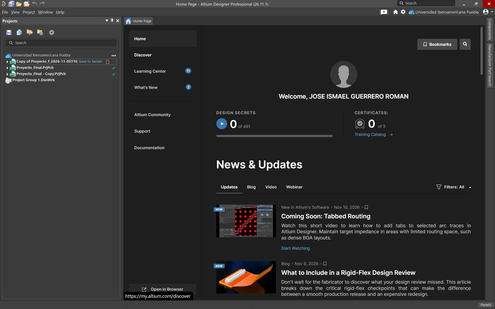

## Un concepto importante: la interfaz es contextual

Altium cambia muchas de sus opciones dependiendo del documento que se encuentre activo.

Por ejemplo:

- Si seleccionamos un archivo `.SchDoc`, aparecerán herramientas relacionadas con esquemáticos.
- Si seleccionamos un `.PcbDoc`, aparecerán herramientas relacionadas con diseño físico de PCB.
- Si abrimos una `.SchLib`, entraremos al editor de símbolos.
- Si abrimos una `.PcbLib`, entraremos al editor de footprints.

Por esta razón, si una herramienta descrita en esta guía no aparece, una de las primeras cosas que debemos comprobar es **qué documento se encuentra activo**.

---

# 3. Tipos de archivos utilizados por Altium Designer

Antes de comenzar es importante comprender los principales archivos que encontraremos.

## `.PrjPcb`

Es el archivo principal del proyecto PCB.

Ejemplo:

```text
MiProyecto.PrjPcb
```

No contiene físicamente todo el diseño dentro de un único archivo. Funciona principalmente como el archivo que organiza los documentos pertenecientes al proyecto y determinadas configuraciones.

---

## `.SchDoc`

Es un documento de esquemático.

Ejemplo:

```text
Principal.SchDoc
```

Contiene:

- Símbolos electrónicos.
- Pines.
- Wires.
- Net Labels.
- Ports.
- Power Ports.
- Información gráfica.
- Conectividad lógica.

Un proyecto puede contener uno o múltiples `.SchDoc`.

---

## `.PcbDoc`

Es el documento correspondiente al diseño físico de la PCB.

Ejemplo:

```text
Principal.PcbDoc
```

Aquí se encuentran:

- Footprints.
- Pads.
- Tracks.
- Vias.
- Polígonos.
- Capas.
- Contorno de la tarjeta.
- Reglas físicas.
- Información de fabricación.

---

## `.SchLib`

Es una **Schematic Library**.

Contiene símbolos utilizados en el esquemático.

```text
Componentes.SchLib
```

---

## `.PcbLib`

Es una **PCB Library**.

Contiene footprints.

```text
Componentes.PcbLib
```

---

## `.IntLib`

Es una **Integrated Library**.

```text
Componentes.IntLib
```

Puede reunir en un solo paquete la información necesaria para utilizar componentes, incluyendo símbolos y sus modelos asociados.

Es uno de los formatos más cómodos para distribuir bibliotecas externas.

---

## `.OutJob`

Es un archivo de configuración de salidas.

```text
Fabricacion.OutJob
```

Puede utilizarse posteriormente para centralizar la generación de:

- Gerber.
- NC Drill.
- Pick and Place.
- BOM.
- PDF.
- Informes.
- Otros documentos de fabricación.

Su utilización se explicará en la sección correspondiente a fabricación.

---

# 4. Creación de un proyecto PCB

Un proyecto debe crearse antes de comenzar a desarrollar el circuito.

La estructura recomendada consiste en mantener todos los archivos relacionados dentro de una misma carpeta.

Por ejemplo:

```text
MiProyecto/
│
├── MiProyecto.PrjPcb
├── Principal.SchDoc
├── MiProyecto.PcbDoc
├── Libraries/
├── Outputs/
└── Datasheets/
```

Esto facilita:

- Respaldar el proyecto.
- Moverlo entre computadoras.
- Subirlo a GitHub.
- Evitar archivos perdidos.
- Localizar bibliotecas externas.
- Localizar archivos de fabricación.

## Crear un proyecto

Desde Altium Designer crea un nuevo proyecto de tipo PCB.

Una vez creado aparecerá en el panel **Projects**.


## Panel Projects

El panel `Projects` muestra la estructura del proyecto.

Si no se encuentra visible, puede abrirse mediante:

```text
View → Panels → Projects
```

Dependiendo de la configuración de la interfaz también puede encontrarse mediante el botón de paneles ubicado en una esquina de la ventana.

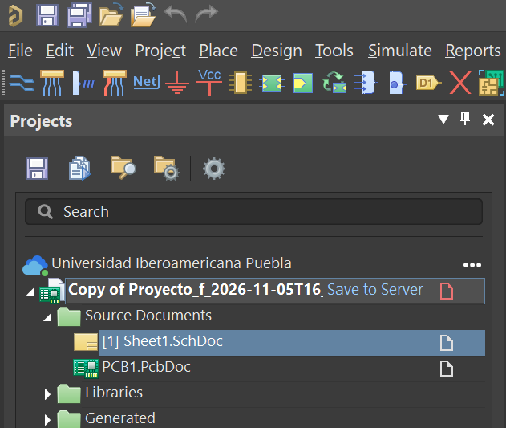

---

## Añadir un esquemático

Sobre el nombre del proyecto:

1. Haz clic derecho.
2. Selecciona:

```text
Add New to Project → Schematic
```

3. Aparecerá un nuevo documento.
4. Guárdalo inmediatamente.
5. Asigna un nombre descriptivo.

Por ejemplo:

```text
Main.SchDoc
```

o:

```text
Power.SchDoc
Control.SchDoc
Inputs.SchDoc
```

---

## Añadir un documento PCB

Sobre el proyecto:

1. Haz clic derecho.
2. Selecciona:

```text
Add New to Project → PCB
```

3. Guarda el archivo.

Por ejemplo:

```text
Main.PcbDoc
```

Todavía no es necesario diseñar la placa. El documento puede permanecer vacío mientras desarrollamos el esquemático.


---

# 5. Paneles principales de Altium Designer

Los paneles son fundamentales para trabajar eficientemente.

En general pueden abrirse desde:

```text
View → Panels
```

Algunos de los paneles que utilizaremos con mayor frecuencia son:

| Panel | Función |
|---|---|
| `Projects` | Administrar documentos del proyecto |
| `Properties` | Modificar las propiedades del objeto seleccionado |
| `Components` | Buscar y colocar componentes |
| `Messages` | Mostrar errores y advertencias |
| `PCB` | Navegar elementos del PCB |
| `PCB Filter` | Filtrar objetos mediante consultas |
| `PCB Rules And Violations` | Inspeccionar reglas y violaciones |
| `SCH Filter` | Filtrar elementos del esquemático |

---

## Panel Properties

Uno de los paneles más importantes es:

```text
Properties
```

Su contenido cambia automáticamente según lo seleccionado.

Por ejemplo:

Si seleccionas una resistencia, mostrará sus propiedades.

Si seleccionas una pista, mostrará:

- ancho;
- capa;
- net;
- coordenadas.

Si no seleccionas ningún objeto en un esquemático, mostrará las propiedades de la hoja.

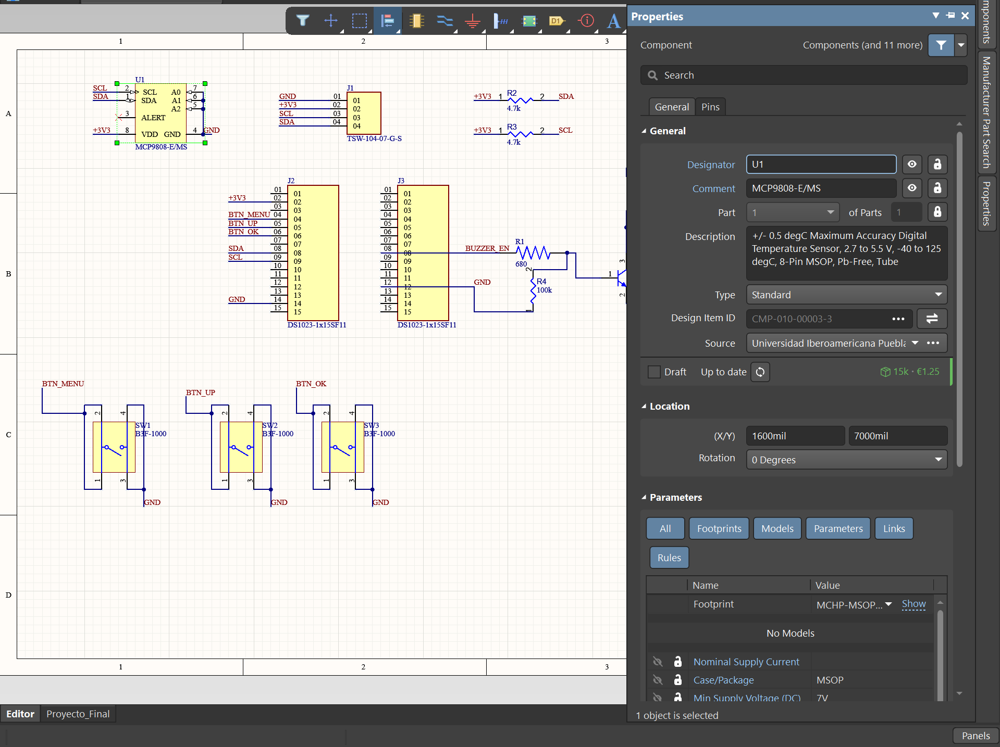

> [!IMPORTANT]
> Cuando una opción que buscas no aparece, primero haz clic en un espacio vacío del documento. En muchas ocasiones el panel `Properties` está mostrando las propiedades del objeto seleccionado en lugar de las opciones del documento.

---

# 6. Navegación dentro del espacio de trabajo

Antes de comenzar un diseño es importante familiarizarse con la navegación.

Altium permite:

- acercar;
- alejar;
- desplazarse;
- seleccionar;
- mover objetos;
- arrastrar conexiones;
- editar propiedades.

La rueda del ratón es una de las herramientas principales para navegar.

El comportamiento exacto puede depender de las preferencias configuradas.

---

## Selección

Para seleccionar un objeto:

```text
clic izquierdo
```

Una vez seleccionado pueden aparecer:

- manejadores;
- contornos;
- información en `Properties`.

Para seleccionar múltiples objetos puede emplearse una ventana de selección o las teclas modificadoras correspondientes.

---

## Cancelar una herramienta

Una operación fundamental en Altium es:

```text
Esc
```

`Esc` permite salir progresivamente de una herramienta.

Por ejemplo:

1. Estamos colocando un Wire.
2. Presionamos `Esc`.
3. Se termina el Wire actual.
4. Podemos presionar nuevamente `Esc` para abandonar completamente la herramienta.

Dependiendo de la operación pueden requerirse uno o varios `Esc`.

---

# 7. Configuración de unidades y cuadrícula

La cuadrícula o **Grid** determina los incrementos utilizados para colocar objetos.

Es extremadamente importante tanto en el esquemático como en la PCB.

---

## Grid del esquemático

Con un `.SchDoc` abierto:

1. Haz clic en un espacio vacío.
2. Abre el panel:

```text
Properties
```

3. Busca las opciones correspondientes al Grid.

Aquí encontraremos conceptos como:

### Visible Grid

Determina la cuadrícula que podemos ver visualmente.

### Snap Grid

Determina los incrementos a los que se ajustan los objetos al moverlos.

### Electrical Snap

Ayuda a que el cursor se adhiera a puntos eléctricamente conectables, como:

- extremos de pines;
- Wires;
- puntos de conexión.


---

## Cambiar rápidamente el Snap Grid

Altium permite recorrer los valores de cuadrícula configurados utilizando:

```text
G
```

Esto resulta especialmente útil cuando necesitamos:

- una cuadrícula grande para organizar bloques;
- una cuadrícula más pequeña para realizar ajustes.

> [!WARNING]
> Evita reducir excesivamente el Grid del esquemático sin necesidad. Los pines de los componentes suelen estar diseñados para trabajar sobre una cuadrícula determinada. Una mala configuración puede provocar que visualmente parezca que un Wire toca un pin cuando eléctricamente no se encuentra conectado.

---

## Unidades

Altium puede trabajar principalmente con:

```text
mil
```

y:

```text
mm
```

Un `mil` corresponde a una milésima de pulgada.

En diseño PCB es común trabajar en milímetros, especialmente cuando las dimensiones mecánicas y especificaciones del fabricante se proporcionan en sistema métrico.

La unidad activa puede modificarse desde las opciones de visualización o propiedades del documento.

> [!NOTE]
> No confundir `mil` con `mm`. Son unidades completamente diferentes.

---

# 8. Componentes, símbolos, footprints y modelos 3D

Este concepto es fundamental para entender Altium Designer.

Un **componente electrónico completo** puede contener diferentes representaciones.

## Símbolo esquemático

Es la representación lógica del componente.

Ejemplo:

```text
Resistencia
```

Puede representarse como:

```text
--/\/\/\--
```

Su función es facilitar la interpretación eléctrica.

No representa necesariamente las dimensiones físicas reales.

---

## Footprint

El **footprint** representa cómo se instalará físicamente el componente sobre la PCB.

Contiene elementos como:

- Pads.
- Separaciones.
- Serigrafía.
- Contorno.
- Información mecánica.

Por ejemplo, una resistencia podría utilizar:

```text
0603
0805
1206
Axial
```

Aunque eléctricamente todas sean resistencias, físicamente son componentes distintos.

---

## Modelo 3D

El modelo 3D permite visualizar la apariencia física aproximada del componente.

Puede utilizar formatos como:

```text
.STEP
.STP
```

El modelo 3D no determina la conectividad eléctrica.

---

## Relación entre los tres

Podemos imaginar la estructura de un componente como:

```text
COMPONENTE
│
├── Símbolo esquemático
│
├── Footprint PCB
│
├── Modelo 3D
│
└── Parámetros
    ├── Valor
    ├── Fabricante
    ├── Número de parte
    └── Descripción
```

> [!IMPORTANT]
> Que un componente aparezca correctamente en el esquemático **no significa que esté listo para pasar al PCB**.

Debe contar con un footprint correctamente asociado.

---

# 9. Bibliotecas en Altium Designer

Las bibliotecas permiten almacenar componentes reutilizables.

Entre los principales formatos encontraremos:

```text
.SchLib
.PcbLib
.IntLib
```

---

## Schematic Library

Archivo:

```text
*.SchLib
```

Contiene principalmente símbolos de esquemático.

---

## PCB Library

Archivo:

```text
*.PcbLib
```

Contiene footprints.

Puede incluir también información tridimensional asociada.

---

## Integrated Library

Archivo:

```text
*.IntLib
```

Una biblioteca integrada permite empaquetar componentes y sus modelos asociados de una manera más cómoda para distribución.

Por esta razón, cuando descargamos una biblioteca externa es bastante común encontrar:

```text
Componente.IntLib
```

---

# 10. Importación de una biblioteca externa

Si disponemos de una biblioteca `.IntLib`, podemos instalarla directamente en Altium.

## Método mediante archivo

1. Descarga la biblioteca.
2. Descomprime el archivo si se encuentra dentro de un `.ZIP`.
3. Localiza:

```text
*.IntLib
```

4. Abre el archivo con Altium Designer.

En muchas situaciones puede hacerse:

```text
doble clic sobre el archivo .IntLib
```

También puede arrastrarse hacia Altium Designer.

Altium puede ofrecer opciones como:

```text
Install Library
```

o:

```text
Extract Sources
```

---

## Install Library

Esta es la opción adecuada cuando solamente queremos utilizar los componentes.

Selecciona:

```text
Install Library
```

La biblioteca quedará disponible entre las bibliotecas basadas en archivos instaladas.

---

## Extract Sources

Esta opción extrae los archivos fuente utilizados para construir la biblioteca.

Es útil cuando:

- queremos editar el símbolo;
- queremos modificar el footprint;
- queremos inspeccionar la biblioteca;
- queremos desarrollar una versión personalizada.

Para utilizar simplemente el componente normalmente no será necesario extraer los fuentes.

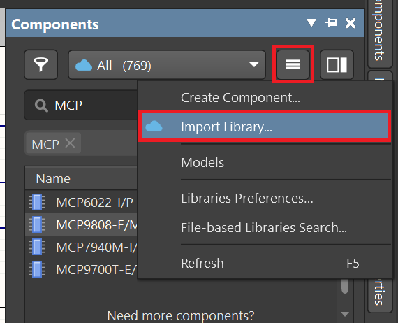

---

## Comprobar que la biblioteca fue instalada

Abre:

```text
View → Panels → Components
```

Dentro del panel `Components`, utiliza el selector de fuente o biblioteca.

Busca la biblioteca recién instalada.

Posteriormente busca uno de sus componentes.

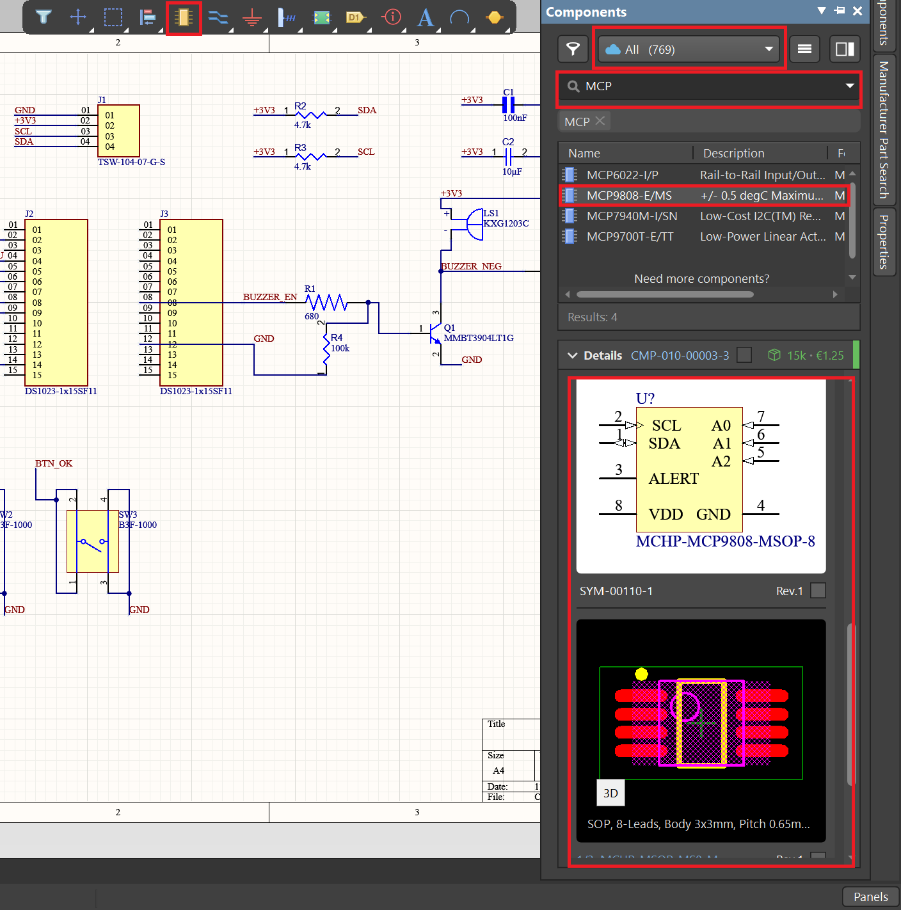

---

# 11. Uso de SnapMagic para encontrar componentes

En muchos proyectos encontraremos componentes que no aparecen directamente en las bibliotecas disponibles.

En estos casos puede utilizarse **SnapMagic**.

SnapMagic permite buscar componentes electrónicos y, cuando existe un modelo disponible, descargar información como:

- símbolo esquemático;
- footprint;
- modelo 3D;
- información paramétrica.

> [!IMPORTANT]
> Una biblioteca descargada de Internet nunca debe utilizarse ciegamente. Antes de fabricar una PCB debemos comprobar manualmente las dimensiones y la correspondencia entre pines y pads utilizando el datasheet oficial del componente.

---

## Buscar un componente

La forma más segura de encontrar un dispositivo es utilizar su:

```text
Manufacturer Part Number
```

o número exacto de parte.

Por ejemplo, en lugar de buscar:

```text
regulador 5V
```

conviene buscar:

```text
<Número exacto del fabricante>
```

Esto reduce el riesgo de seleccionar:

- otro encapsulado;
- otra variante;
- otra distribución de pines.


---

## Seleccionar formato para Altium

Dentro de la página del componente:

1. Comprueba que el dispositivo sea exactamente el correcto.
2. Revisa fabricante.
3. Revisa número de parte.
4. Comprueba encapsulado.
5. Selecciona el formato compatible con:

```text
Altium Designer
```

6. Descarga los archivos.


---

## Importar un `.IntLib` de SnapMagic

Si el archivo descargado contiene:

```text
*.IntLib
```

realiza el siguiente procedimiento:

1. Descomprime el archivo.
2. Localiza el `.IntLib`.
3. Haz doble clic sobre él o arrástralo a Altium.
4. Selecciona:

```text
Install Library
```

5. Abre:

```text
View → Panels → Components
```

6. Busca el componente.
7. Comprueba símbolo.
8. Comprueba footprint.


---

## Si SnapMagic entrega un archivo `.lia`

Algunas bibliotecas antiguas pueden encontrarse en formato:

```text
.lia
```

Este formato procede del ecosistema P-CAD.

Altium puede importarlo mediante su correspondiente **P-CAD Importer**.

Si Altium no reconoce el archivo, revisa que el importador se encuentre instalado desde las opciones de instalación/extensiones.

Para proyectos nuevos es preferible utilizar el formato nativo de Altium cuando se encuentre disponible.

---

# 12. El editor de esquemas

El **Schematic Editor** permite representar la lógica eléctrica del circuito.

Aquí definiremos:

- componentes;
- conexiones;
- alimentación;
- señales;
- nombres de redes;
- referencias;
- bloques funcionales.

Todavía no estamos definiendo por dónde pasarán físicamente las pistas.

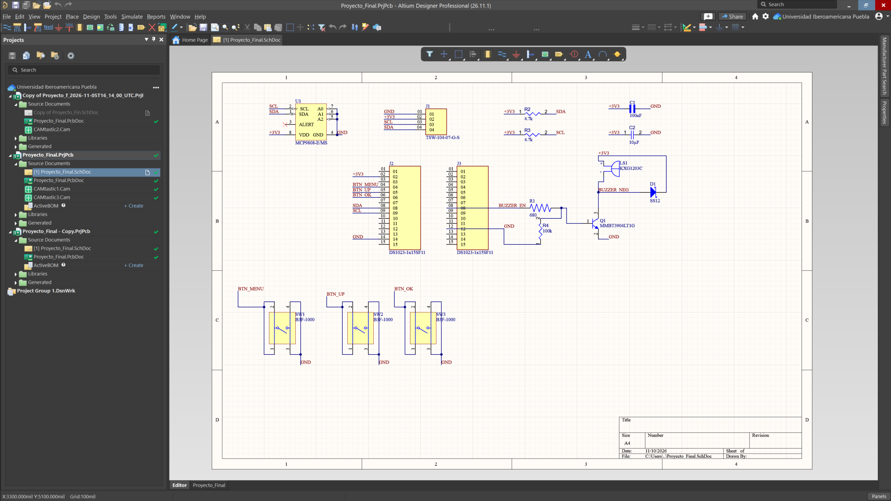

---

# 13. Configuración inicial de una hoja de esquemático

Antes de comenzar a colocar componentes conviene configurar la hoja.

Con el `.SchDoc` abierto:

1. Haz clic en un lugar vacío.
2. Abre:

```text
View → Panels → Properties
```

3. El panel mostrará las opciones del documento.

Desde aquí pueden controlarse opciones relacionadas con:

- tamaño de hoja;
- unidades;
- cuadrícula;
- snapping;
- plantillas.


---

## Tamaño de hoja

El tamaño de la hoja no modifica eléctricamente el circuito.

Sin embargo, utilizar un tamaño adecuado facilita mantener el esquemático limpio.

Para diseños pequeños puede utilizarse una hoja estándar.

Para proyectos grandes puede ser preferible:

- utilizar una hoja mayor;
- dividir el circuito en múltiples `.SchDoc`.

---

# 14. Inserción de componentes

Los componentes pueden colocarse principalmente desde el panel:

```text
Components
```

Para abrirlo:

```text
View → Panels → Components
```

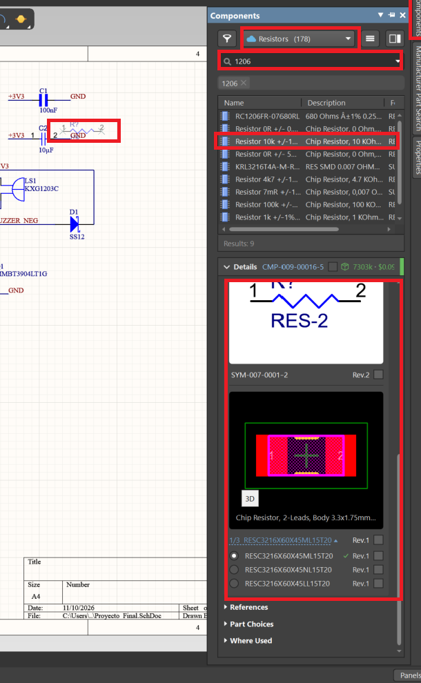

---

## Buscar un componente

Dentro del panel:

1. Selecciona la biblioteca correspondiente.
2. Utiliza el campo de búsqueda.
3. Introduce el nombre o número de parte.
4. Selecciona el componente.

Antes de colocarlo, revisa la información disponible.

Especialmente:

- nombre;
- descripción;
- footprint;
- fabricante;
- número de parte.

---

## Colocar el componente

Selecciona el componente y utiliza la opción:

```text
Place
```

También puede ser posible:

- hacer doble clic;
- arrastrar el componente hacia la hoja.

Una vez que el componente aparezca unido al cursor:

1. Muévelo a la posición deseada.
2. Oriéntalo correctamente.
3. Haz clic izquierdo para colocarlo.
4. Presiona `Esc` cuando termines.

---

# 15. Propiedades de los componentes

Selecciona un componente.

El panel:

```text
Properties
```

mostrará sus propiedades.

Entre las más importantes encontraremos:

### Designator

Identificación única del componente.

Ejemplos:

```text
R1
R2
C1
U1
D1
J1
```

---

### Comment

Descripción o valor asociado.

Por ejemplo:

```text
10k
100nF
LM358
```

---

### Parameters

Información adicional como:

- fabricante;
- número de parte;
- descripción;
- voltaje;
- tolerancia;
- documentación.

---

### Models

Aquí pueden encontrarse modelos asociados, especialmente el footprint.

> [!IMPORTANT]
> Antes de transferir un componente al PCB debemos comprobar que tenga un footprint asociado.

---

# 16. Mover, rotar y reflejar componentes

Durante la colocación podemos modificar la orientación.

## Rotar

Mientras el componente está unido al cursor:

```text
Space
```

permite rotarlo.

Las rotaciones normalmente se realizan en incrementos de:

```text
90°
```


---

## Reflejar

Durante la colocación pueden utilizarse:

```text
X
```

o:

```text
Y
```

para reflejar el componente respecto a determinados ejes.

---

## Editar durante la colocación

Mientras un objeto se encuentra en proceso de colocación puede utilizarse:

```text
Tab
```

para acceder a sus propiedades antes de colocarlo definitivamente.

Esta función resulta extremadamente útil en Altium.

La lógica general es:

```text
Seleccionar herramienta
        ↓
Objeto unido al cursor
        ↓
Presionar Tab
        ↓
Modificar propiedades
        ↓
Regresar a la colocación
```

---

# 17. Designadores y anotación automática

Cada componente debe tener un identificador único.

Por ejemplo:

```text
R1
R2
R3
```

No deberían existir dos componentes con:

```text
R1
```

dentro del mismo alcance en el que los designadores deban ser únicos.

Altium puede asignarlos automáticamente mediante la herramienta de **Annotation**.

---

## Anotar el esquemático

Dirígete a:

```text
Tools → Annotation → Annotate Schematics
```

Se abrirá la ventana de anotación.

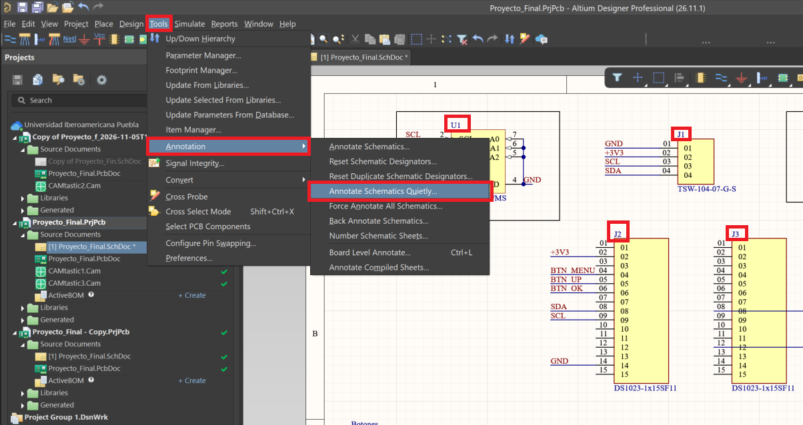

La herramienta analiza los componentes y propone designadores.

Por ejemplo:

```text
R? → R1
R? → R2
R? → R3

C? → C1
C? → C2

U? → U1
```

---

## Procedimiento recomendado

1. Coloca los componentes.
2. Organízalos.
3. Abre:

```text
Tools → Annotation → Annotate Schematics
```

4. Configura el alcance.
5. Genera la lista de cambios propuesta.
6. Revisa los cambios.
7. Aplícalos.
8. Comprueba que todos los componentes tengan designadores únicos.

> [!TIP]
> Es recomendable realizar una anotación ordenada antes de transferir el diseño al PCB. Esto facilita identificar físicamente cada componente posteriormente.

---

# 18. Conexiones mediante Wire

Una de las diferencias más importantes que debe aprender un usuario nuevo es:

> **Una línea gráfica no es lo mismo que un Wire.**

Para realizar una conexión eléctrica se utiliza:

```text
Place → Wire
```

Altium también dispone de objetos gráficos como:

```text
Place → Line
```

pero una `Line` sirve únicamente para dibujo.

**No genera conectividad eléctrica.**

---

## Colocar un Wire

1. Selecciona:

```text
Place → Wire
```

2. Acerca el cursor al extremo eléctrico de un pin.
3. Haz clic.
4. Mueve el cursor hacia el siguiente punto.
5. Haz clic para crear esquinas cuando sea necesario.
6. Llega hasta el pin de destino.
7. Haz clic para finalizar la conexión.
8. Presiona `Esc` para terminar.
9. Presiona nuevamente `Esc` si deseas abandonar completamente la herramienta.

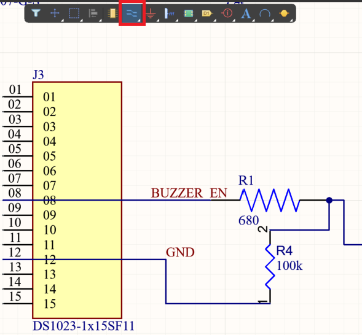

---

## Cómo comprobar una conexión

No basta con que las líneas parezcan tocarse.

Debemos comprobar que:

- el Wire llegó al hotspot eléctrico del pin;
- no existe un pequeño espacio;
- no se utilizó una `Line`;
- el Wire se encuentra realmente unido a la red.

> [!WARNING]
> Uno de los errores más peligrosos para principiantes es dibujar conexiones utilizando objetos gráficos. El esquemático puede parecer perfectamente conectado mientras eléctricamente los componentes permanecen separados.

---

# 19. Junctions y conexiones eléctricas

Cuando varios Wires se unen puede utilizarse un **Junction** para indicar claramente la unión eléctrica.

Visualmente suele representarse mediante un punto.

Ejemplo:

```text
        |
        |
--------●--------
        |
        |
```

El punto indica que las líneas pertenecen a una misma conexión.

---

## Cruce sin conexión

Dos líneas también pueden cruzarse sin pertenecer a la misma red.

Por esta razón debemos evitar esquemas ambiguos.

Preferiblemente:

- utiliza Junctions donde realmente exista una unión;
- evita cruces innecesarios;
- utiliza Net Labels cuando el cableado se vuelva complejo.


---

# 20. Net Labels

Las **Net Labels** permiten asignar nombres a redes.

Son especialmente útiles para evitar llenar el esquemático con cables largos.

Para colocar una:

```text
Place → Net Label
```

---

## Procedimiento

1. Crea un Wire corto desde el pin.
2. Selecciona:

```text
Place → Net Label
```

3. Presiona:

```text
Tab
```

4. En `Properties`, escribe el nombre en:

```text
Net Name
```

5. Regresa al modo de colocación.
6. Coloca la etiqueta sobre el Wire.
7. Verifica que el hotspot de la etiqueta quede conectado.

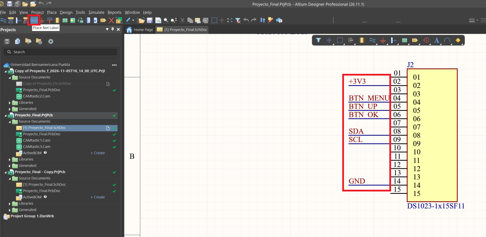

---

## Ejemplo

Tenemos dos puntos separados.

Primer punto:

```text
MCU -------- DATA
```

Segundo punto:

```text
DATA -------- SENSOR
```

Al utilizar la misma Net Label:

```text
DATA
```

Altium entiende que pertenecen a la misma red según el alcance de conectividad configurado.

---

## Nombres recomendados

Utiliza nombres claros.

Por ejemplo:

```text
SDA
SCL
TX
RX
RESET
MOTOR_EN
LED_STATUS
5V
3V3
GND
```

Evita nombres ambiguos como:

```text
A
B
X1
TEMP2
```

cuando no indiquen claramente la función.

---

# 21. Ports

Los **Ports** también permiten identificar y conectar señales, especialmente cuando el diseño utiliza múltiples hojas.

Se colocan mediante:

```text
Place → Port
```

Los Ports son particularmente útiles en diseños:

- jerárquicos;
- con múltiples hojas;
- divididos en bloques funcionales.

Por ejemplo:

```text
Power.SchDoc
      │
      └── 5V

Main.SchDoc
      │
      └── 5V
```

Sin embargo, la forma en que Ports y Net Labels conectan entre diferentes hojas depende de la estructura del proyecto y de la configuración del alcance de los identificadores de red.

> [!IMPORTANT]
> No debes asumir que cualquier Net Label con el mismo nombre conecta automáticamente todas las hojas. Para diseños de múltiples hojas es necesario comprender la configuración de conectividad y jerarquía utilizada por el proyecto.

---

# 22. Alimentación y tierra mediante Power Ports

Para representar redes como:

```text
GND
VCC
5V
3V3
12V
```

pueden utilizarse **Power Ports**.

La herramienta se encuentra en:

```text
Place → Power Port
```

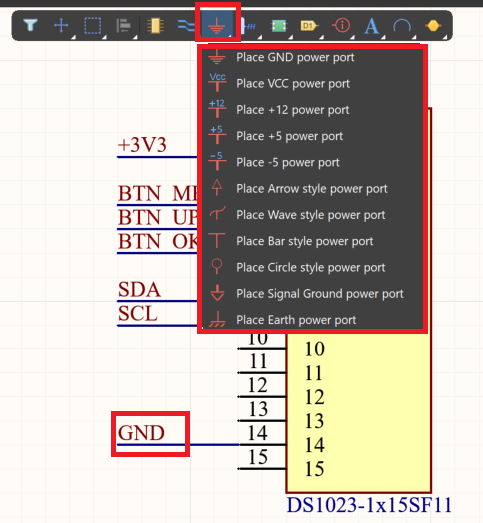

---

## Colocar GND

1. Selecciona:

```text
Place → Power Port
```

2. Presiona `Tab` si necesitas modificar las propiedades.
3. Configura el nombre de la red:

```text
GND
```

4. Selecciona el estilo gráfico deseado.
5. Coloca el Power Port sobre el Wire o pin correspondiente.

---

## Lo verdaderamente importante es el nombre

Es fundamental comprender que el símbolo visual no determina por sí mismo la conexión.

Por ejemplo, podemos tener distintos estilos gráficos.

Lo que realmente determina la red es:

```text
Net Name
```

Por tanto:

```text
GND
```

debe conectarse con otros Power Ports llamados:

```text
GND
```

---

## Ejemplo

```text
          5V
          │
       ┌──┴──┐
       │ MCU │
       └──┬──┘
          │
         GND
```

---

## Redes globales de alimentación

En configuraciones normales, los Power Ports se utilizan para crear redes de alimentación disponibles a través del proyecto.

Esto hace que sea posible evitar líneas de alimentación que atraviesen todo el esquemático.

> [!WARNING]
> No cambies únicamente el dibujo del Power Port suponiendo que eso cambia la señal. Siempre comprueba el nombre eléctrico de la red.

---

# 23. Elementos gráficos y documentación del esquemático

Además de objetos eléctricos, Altium permite colocar elementos gráficos.

Estos sirven para mejorar la documentación y organización.

Entre ellos pueden encontrarse:

- Lines.
- Rectangles.
- Text Strings.
- Text Frames.
- elementos gráficos adicionales.

---

## Texto

Puede añadirse texto para describir bloques.

Ejemplos:

```text
ALIMENTACIÓN
```

```text
ENTRADAS DIGITALES
```

```text
MICROCONTROLADOR
```

```text
SENSORES
```

El texto es informativo y no crea conectividad eléctrica.

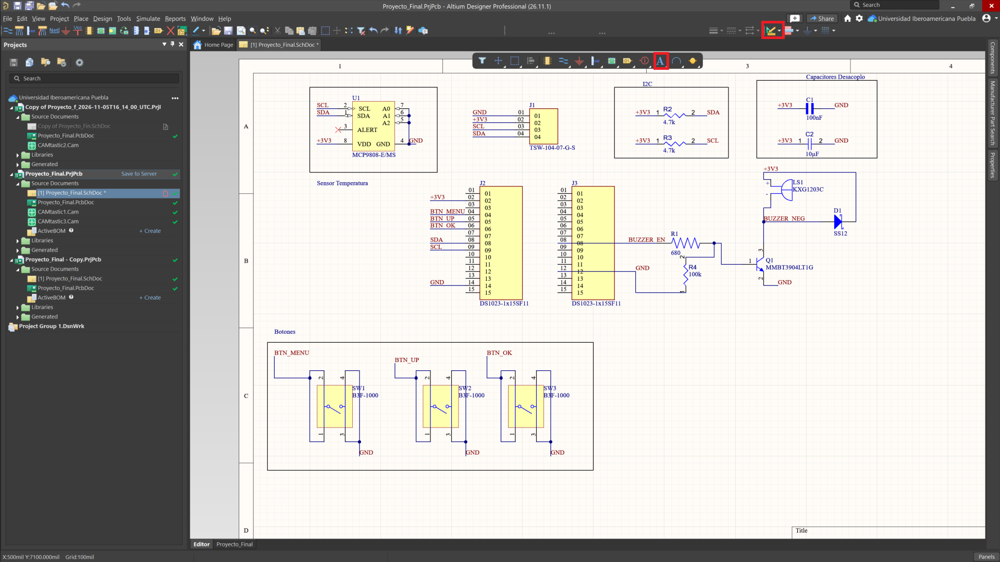

---

## Rectángulos

Los rectángulos pueden utilizarse para agrupar visualmente bloques.

Ejemplo:

```text
┌─────────────────────────────┐
│       ALIMENTACIÓN          │
│                             │
│    Regulador                │
│    Capacitores              │
│    Conector                 │
│                             │
└─────────────────────────────┘
```

---

## Line frente a Wire

Este punto merece repetirse:

```text
Wire = conexión eléctrica
```

```text
Line = elemento gráfico
```

Nunca utilices `Line` para representar una conexión eléctrica.

---

# 24. Organización recomendada del esquemático

Un esquemático debe diseñarse para que una persona pueda comprenderlo.

No solamente para que Altium pueda interpretarlo.

---

## Divide el circuito en bloques

Por ejemplo:

```text
POWER
```

```text
MICROCONTROLLER
```

```text
INPUTS
```

```text
OUTPUTS
```

```text
COMMUNICATION
```

```text
SENSORS
```

---

## Flujo visual recomendado

Siempre que sea posible:

```text
ENTRADAS → PROCESAMIENTO → SALIDAS
```

y:

```text
ALIMENTACIÓN
      ↓
   CIRCUITO
      ↓
     GND
```

Esto facilita enormemente la lectura.

---

## Evita cables extremadamente largos

En lugar de:

```text
Componente ------------------------------ Componente
```

utiliza Net Labels cuando sea apropiado.

---

## Mantén nombres consistentes

Evita mezclar:

```text
+5V
5V
VCC5
VCC_5V
```

si todos representan exactamente la misma alimentación.

Selecciona una convención.

Por ejemplo:

```text
5V
3V3
GND
```

---

## Mantén el Grid

No coloques arbitrariamente objetos fuera de la cuadrícula para intentar que visualmente se vean mejor.

La conectividad debe tener prioridad sobre pequeños ajustes estéticos.

---

# 25. Validación eléctrica del proyecto

Una vez terminado el esquemático debemos comprobarlo antes de transferirlo al PCB.

Altium dispone de un sistema de validación del proyecto.

Con el proyecto activo utiliza:

```text
Project → Validate PCB Project <NombreDelProyecto>
```

También puede realizarse desde el panel `Projects` mediante las opciones disponibles al hacer clic derecho sobre el proyecto.


---

## ¿Qué comprueba la validación?

Dependiendo de la configuración puede detectar problemas como:

- designadores duplicados;
- conexiones incompatibles;
- Wires flotantes;
- Net Labels flotantes;
- redes con problemas;
- componentes incompletos;
- conflictos eléctricos;
- problemas relacionados con pines;
- errores de documentación lógica.

---

# 26. Configuración del ERC

Las comprobaciones eléctricas dependen de las opciones configuradas para el proyecto.

Abre:

```text
Project → Project Options
```

Dentro encontraremos apartados importantes como:

```text
Error Reporting
```

y:

```text
Connection Matrix
```


---

## Error Reporting

Permite determinar cómo debe tratarse cada tipo de problema.

Por ejemplo:

```text
Fatal Error
Error
Warning
No Report
```

No todos los proyectos necesitan exactamente la misma configuración.

---

## Connection Matrix

La matriz de conexión determina qué tipos de conexiones entre pines deben considerarse correctas, advertencias o errores.

Por ejemplo, una conexión entre:

```text
Output → Output
```

puede representar un conflicto.

Mientras:

```text
Passive → Passive
```

puede ser perfectamente válida.


---

> [!WARNING]
> No soluciones un ERC simplemente cambiando todos los errores a `No Report`.

El ERC existe precisamente para detectar errores reales.

Primero debe comprenderse la causa.

Solo debemos modificar una regla cuando sabemos que el comportamiento es intencional.

---

# 27. Panel Messages

Después de ejecutar la validación, los problemas pueden visualizarse en:

```text
View → Panels → Messages
```

El panel muestra:

- errores;
- advertencias;
- documento;
- descripción;
- objeto implicado.

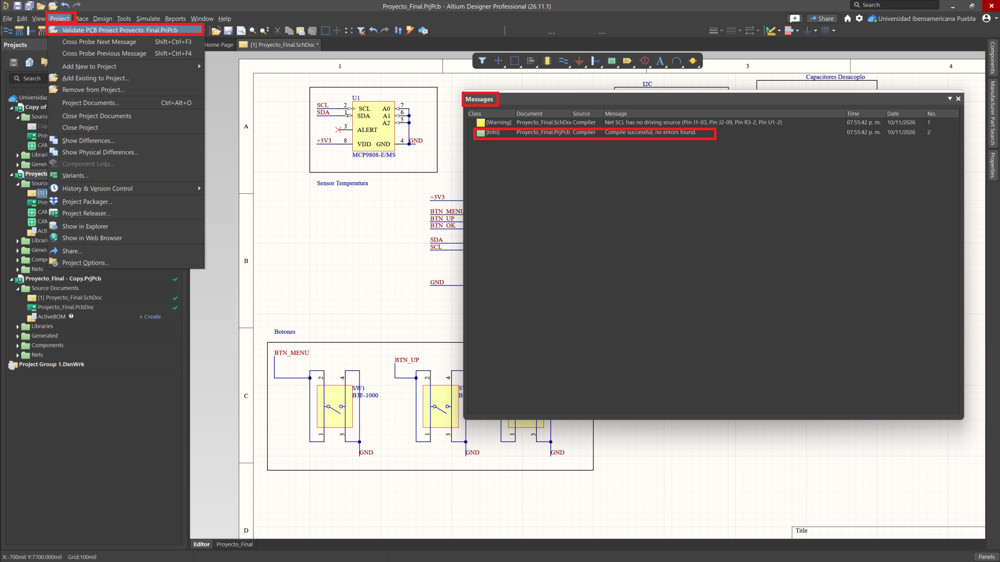

---

## Localizar un error

Una de las funciones más útiles del panel consiste en hacer doble clic sobre el problema.

Altium puede llevarnos directamente al objeto involucrado.

Flujo recomendado:

```text
Validate PCB Project
        ↓
Messages
        ↓
Seleccionar error
        ↓
Localizar objeto
        ↓
Corregir
        ↓
Validar nuevamente
```

---

## Limpiar mensajes no corrige los errores

Eliminar mensajes del panel solamente limpia la visualización.

No modifica el diseño.

Si volvemos a ejecutar:

```text
Validate PCB Project
```

los errores que continúen presentes volverán a aparecer.

---

# 28. No ERC

Existen situaciones donde una condición detectada por el ERC es intencional.

En esos casos puede utilizarse una directiva:

```text
No ERC
```

Su propósito es indicarle al sistema que una condición determinada ha sido revisada y debe ignorarse.

---

## Cuándo utilizar No ERC

Ejemplos razonables pueden incluir determinados pines intencionalmente no conectados.

Sin embargo, debemos utilizarlo únicamente cuando:

1. conocemos el motivo de la advertencia;
2. sabemos que la condición es intencional;
3. sabemos que el circuito es eléctricamente correcto.

---

## Procedimiento recomendado

Nunca utilizar esta secuencia:

```text
Aparece error
      ↓
No entiendo el error
      ↓
Coloco No ERC
```

Utilizar:

```text
Aparece error
      ↓
Analizo el problema
      ↓
Compruebo datasheet y diseño
      ↓
Confirmo que es intencional
      ↓
Coloco No ERC
```

> [!CAUTION]
> `No ERC` no corrige un circuito. Solamente indica al verificador que no debe reportar una condición determinada.

---

# 29. Comprobaciones antes de pasar al PCB

Antes de actualizar el documento PCB es recomendable realizar una revisión completa.

## Componentes

Comprobar que:

- todos los componentes necesarios estén colocados;
- no existan componentes duplicados accidentalmente;
- todos tengan designadores únicos;
- todos tengan valores correctos.

---

## Conectividad

Comprobar:

- Wires.
- Junctions.
- Net Labels.
- Ports.
- Power Ports.
- GND.
- Alimentaciones.

---

## Footprints

Para cada componente físico debemos comprobar:

```text
Símbolo → Footprint
```

No solamente que exista un footprint, sino que sea **el footprint correcto**.

---

## Correspondencia entre pines y pads

Este punto es crítico.

Supongamos que el símbolo tiene:

```text
Pin 1 = GND
Pin 2 = VCC
Pin 3 = OUT
```

El footprint debe corresponder físicamente con:

```text
Pad 1 = GND
Pad 2 = VCC
Pad 3 = OUT
```

Si el footprint utiliza una numeración incorrecta, la PCB puede quedar eléctricamente mal aunque Altium no conozca la intención real del fabricante.

---

## Comparar contra el datasheet

Antes de aceptar un componente externo:

1. Descarga el datasheet oficial.
2. Localiza el pinout.
3. Comprueba numeración.
4. Comprueba orientación.
5. Comprueba dimensiones.
6. Comprueba footprint recomendado.
7. Compara contra el componente utilizado en Altium.

Esto es especialmente importante con componentes obtenidos de:

- SnapMagic;
- bibliotecas externas;
- repositorios;
- componentes creados por terceros.

---

## Validación final del esquemático

Ejecuta nuevamente:

```text
Project → Validate PCB Project <Nombre>
```

Posteriormente revisa:

```text
Messages
```

El objetivo no debe ser simplemente conseguir:

```text
0 Errors
```

sino comprender por qué cualquier advertencia restante puede considerarse aceptable.

---

## Estado esperado antes de continuar

Antes de comenzar el diseño físico deberíamos tener:

```text
Proyecto PCB
│
├── .PrjPcb
│
├── Esquemático
│   ├── componentes
│   ├── conexiones
│   ├── etiquetas
│   ├── alimentación
│   └── designadores
│
├── Footprints asignados
│
├── Validación realizada
│
└── .PcbDoc creado
```

Una vez cumplidos estos puntos estamos listos para transferir la información del esquemático hacia el PCB mediante:

```text
Design → Update PCB Document
```

Este proceso no consiste simplemente en copiar los componentes.

Altium comparará la información lógica del proyecto con el documento PCB y generará una serie de **Engineering Change Orders (ECO)** que deberán validarse y ejecutarse.

A partir de este punto comienza el proceso de diseño físico de la tarjeta.

---

# Continuación

La siguiente parte de la documentación comprende:

```text
Esquemático
      ↓
Update PCB Document
      ↓
Engineering Change Order
      ↓
PCB
      ↓
Board Shape
      ↓
Origen
      ↓
Grid
      ↓
Layer Stack
      ↓
Design Rules
      ↓
Placement
      ↓
Routing
      ↓
Vias
      ↓
Polygons
      ↓
DRC
      ↓
Fabricación
```

En esta etapa aprenderemos a convertir la representación lógica del circuito en una tarjeta físicamente fabricable.
