# Guía esencial de Altium Designer 26.11.1

Esta guía resume las herramientas y procesos indispensables para desarrollar un proyecto de PCB en **Altium Designer**, desde el esquemático hasta la generación de los archivos de fabricación.

No pretende explicar todas las funciones disponibles en Altium, sino servir como referencia rápida para recordar:

- dónde se encuentran las herramientas principales;
- cómo colocar y conectar componentes;
- cómo importar librerías;
- cómo transferir el esquemático al PCB;
- cómo configurar reglas;
- cómo colocar y rutear componentes;
- cómo comprobar el diseño;
- cómo generar los archivos necesarios para fabricación.

> [!NOTE]
> La interfaz de Altium es contextual. Algunas herramientas únicamente aparecen cuando se encuentra activo un documento de esquemático (`.SchDoc`) o PCB (`.PcbDoc`).

---

## Contenido

- [1. Vista general de Altium](#1-vista-general-de-altium)
- [2. Crear y organizar un proyecto](#2-crear-y-organizar-un-proyecto)
- [3. Paneles importantes](#3-paneles-importantes)
- [4. Navegación, Grid y unidades](#4-navegación-grid-y-unidades)
- [5. Componentes y librerías](#5-componentes-y-librerías)
- [6. Importar librerías externas](#6-importar-librerías-externas)
- [7. Editor de esquemáticos](#7-editor-de-esquemáticos)
- [8. Colocar y editar componentes](#8-colocar-y-editar-componentes)
- [9. Conexiones eléctricas](#9-conexiones-eléctricas)
- [10. Net Labels, Ports y alimentación](#10-net-labels-ports-y-alimentación)
- [11. Organización visual del esquemático](#11-organización-visual-del-esquemático)
- [12. Designators y anotación](#12-designators-y-anotación)
- [13. Validar el esquemático](#13-validar-el-esquemático)
- [14. Transferir el diseño al PCB](#14-transferir-el-diseño-al-pcb)
- [15. Vista general del PCB Editor](#15-vista-general-del-pcb-editor)
- [16. Board Shape, origen y Grid](#16-board-shape-origen-y-grid)
- [17. Capas de la PCB](#17-capas-de-la-pcb)
- [18. Layer Stack Manager](#18-layer-stack-manager)
- [19. Placement de componentes](#19-placement-de-componentes)
- [20. Reglas de diseño](#20-reglas-de-diseño)
- [21. Importar reglas](#21-importar-reglas)
- [22. Routing](#22-routing)
- [23. Cambio de capa y vías](#23-cambio-de-capa-y-vías)
- [24. Polygon Pours y planos de GND](#24-polygon-pours-y-planos-de-gnd)
- [25. Auto Route](#25-auto-route)
- [26. DRC y revisión final](#26-drc-y-revisión-final)
- [27. Vista 3D](#27-vista-3d)
- [28. Gerber y archivos de perforación](#28-gerber-y-archivos-de-perforación)
- [29. Flujo general recomendado](#29-flujo-general-recomendado)

---

# 1. Vista general de Altium

Altium Designer integra dentro del mismo programa el diseño del:

```text
Esquemático
    ↓
PCB
    ↓
Archivos de fabricación
```

La interfaz principal contiene:

- barra superior de menús;
- área central de documentos;
- panel `Projects`;
- panel `Properties`;
- panel `Components`;
- herramientas específicas según el documento activo.

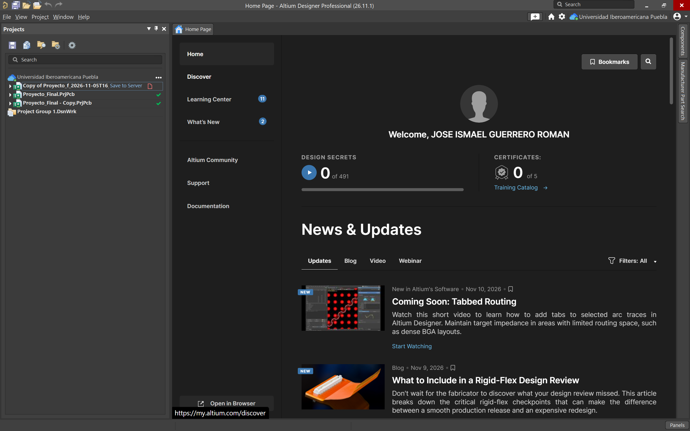

Una característica importante es que las opciones cambian dependiendo del documento activo.

Por ejemplo:

```text
.SchDoc → herramientas de esquemático
.PcbDoc → herramientas de PCB
.SchLib → editor de símbolos
.PcbLib → editor de footprints
```

---

# 2. Crear y organizar un proyecto

Para un diseño de PCB se utiliza un proyecto tipo:

```text
PCB Project
```

Una estructura básica normalmente contiene:

```text
Proyecto
│
├── Proyecto.PrjPcb
├── Main.SchDoc
└── Main.PcbDoc
```

Desde el panel `Projects` pueden añadirse nuevos documentos haciendo clic derecho sobre el proyecto:

```text
Add New to Project → Schematic
```

o:

```text
Add New to Project → PCB
```

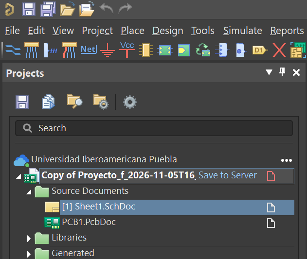

Guarda los documentos desde el principio con nombres claros.

---

# 3. Paneles importantes

Los paneles pueden abrirse desde:

```text
View → Panels
```

Los más importantes son:

| Panel | Uso |
|---|---|
| `Projects` | Archivos y estructura del proyecto |
| `Properties` | Propiedades del objeto seleccionado |
| `Components` | Búsqueda y colocación de componentes |
| `Messages` | Errores y advertencias |
| `View Configuration` | Capas y visualización del PCB |
| `PCB Rules And Violations` | Violaciones de reglas |

El panel más utilizado es:

```text
Properties
```

Su contenido cambia según el objeto seleccionado.

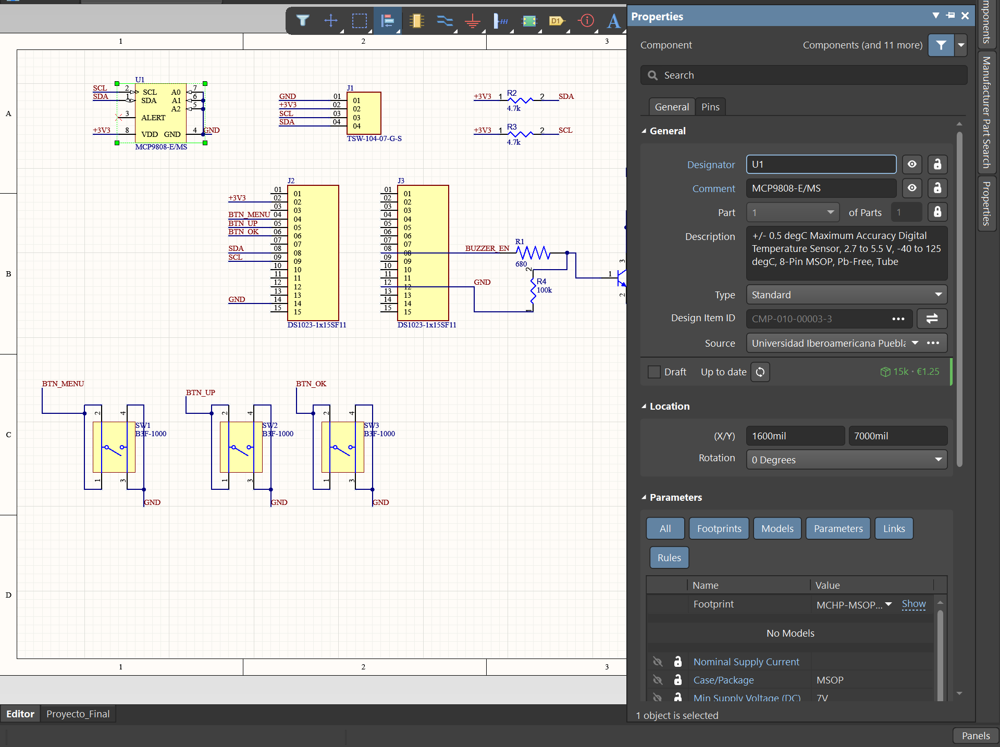

---

# 4. Navegación, Grid y unidades

Durante el diseño es importante trabajar utilizando una cuadrícula o:

```text
Grid
```

El Grid permite mover y colocar objetos sobre posiciones ordenadas.

En muchos contextos puede modificarse rápidamente mediante:

```text
G
```

En el PCB también podemos alternar las unidades utilizando:

```text
Q
```

Normalmente trabajaremos con:

```text
mm
```

o:

```text
mil
```

Para cancelar una herramienta o salir del modo actual utiliza:

```text
Esc
```

Durante muchas herramientas interactivas:

```text
Tab
```

permite abrir las propiedades del objeto que estamos colocando.

---

# 5. Componentes y librerías

Un componente utilizado en un proyecto puede contener diferentes representaciones:

```text
Componente
│
├── Símbolo
├── Footprint
└── Modelo 3D
```

El **símbolo** se utiliza en el esquemático.

El **footprint** representa físicamente el componente en la PCB.

El **modelo 3D** permite revisar su forma física.

> [!IMPORTANT]
> Antes de transferir un componente al PCB comprueba que tenga un footprint correcto.

---

## Buscar componentes

Abre:

```text
View → Panels → Components
```

Desde este panel puedes:

1. seleccionar una librería;
2. buscar un componente;
3. revisar sus datos;
4. colocarlo en el esquemático.

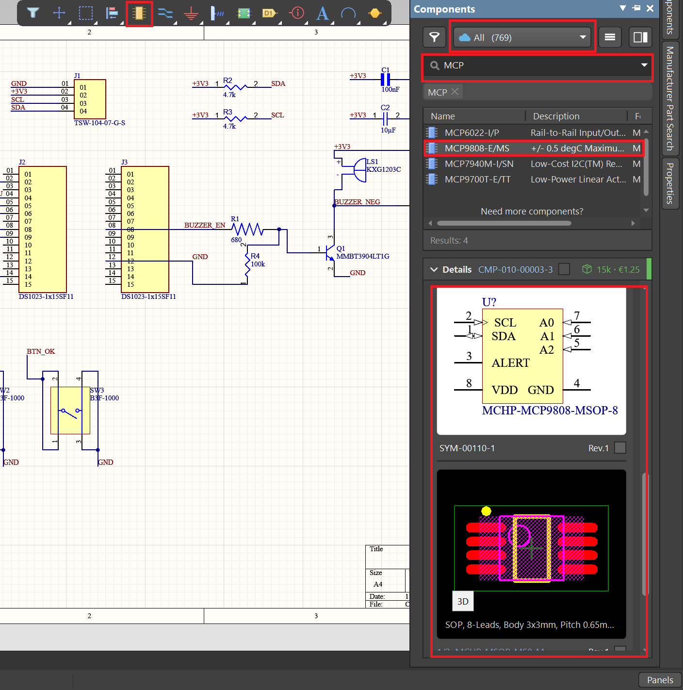

---

## Componentes externos

Si un componente no se encuentra disponible, puede buscarse en plataformas como:

[SnapMagic](https://www.snapeda.com/)

o directamente en el sitio del fabricante.

Cuando sea posible busca utilizando el:

```text
Manufacturer Part Number
```

exacto.

> [!WARNING]
> Comprueba siempre el símbolo, footprint y numeración de pads contra el datasheet oficial antes de fabricar una PCB.

---

# 6. Importar librerías externas

Altium puede utilizar librerías externas como:

```text
.IntLib
.SchLib
.PcbLib
```

Para utilizar una `.IntLib`:

1. descarga y descomprime la librería;
2. localiza el archivo `.IntLib`;
3. ábrelo con Altium;
4. selecciona:

```text
Install Library
```

5. abre:

```text
View → Panels → Components
```

6. comprueba que los componentes aparezcan disponibles.

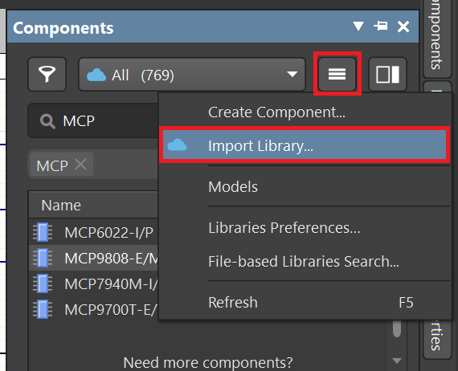

Si únicamente necesitas utilizar el componente no es necesario modificar los archivos fuente de la librería.

---

# 7. Editor de esquemáticos

El `.SchDoc` contiene la representación lógica del circuito.

Aquí se colocan:

- componentes;
- conexiones;
- Net Labels;
- Ports;
- Power Ports;
- textos y elementos gráficos.

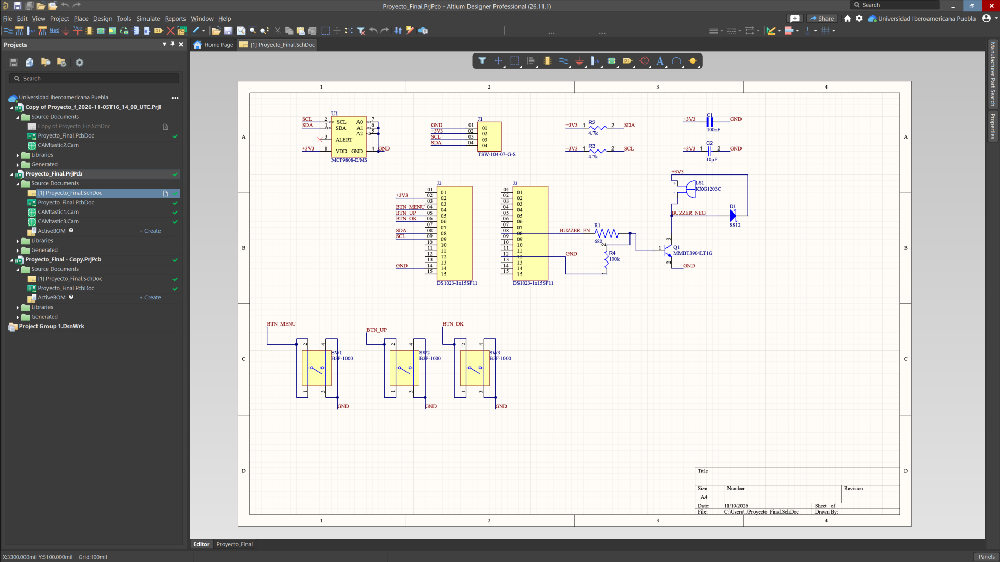

Antes de comenzar comprueba que el Grid permita conectar correctamente los pines de los componentes.

---

# 8. Colocar y editar componentes

Abre:

```text
View → Panels → Components
```

Busca el componente y utiliza:

```text
Place
```

Una vez unido al cursor:

```text
clic izquierdo → colocar
Space → rotar
X / Y → reflejar durante determinadas operaciones
Tab → modificar propiedades
Esc → terminar
```

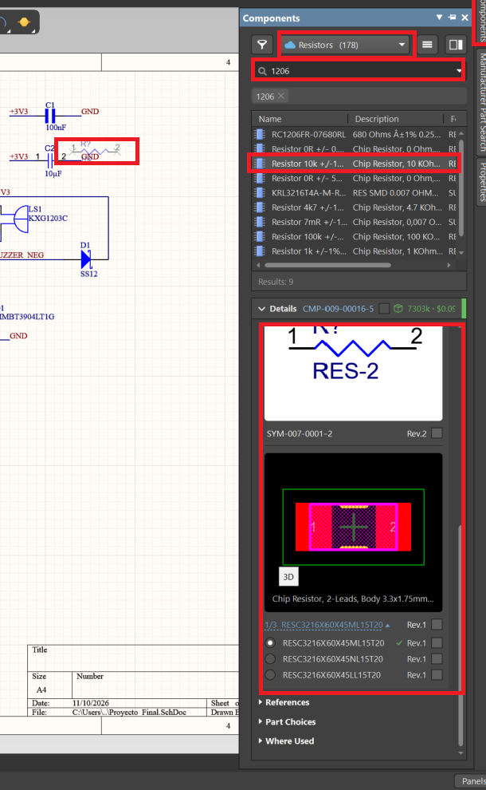

Las propiedades importantes normalmente incluyen:

```text
Designator
Comment
Parameters
Models
```

Ejemplos de Designators:

```text
R1
C1
U1
D1
J1
```

---

# 9. Conexiones eléctricas

Para conectar eléctricamente componentes utiliza:

```text
Place → Wire
```

Procedimiento:

1. selecciona `Wire`;
2. haz clic sobre el extremo del primer pin;
3. guía el cable;
4. haz clic para crear esquinas;
5. llega al pin destino;
6. termina con `Esc`.

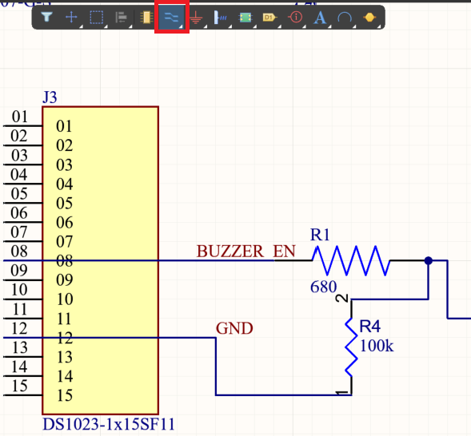

> [!IMPORTANT]
> `Wire` y `Line` no son lo mismo.

```text
Wire → conexión eléctrica
Line → dibujo
```

Nunca utilices una línea gráfica para sustituir un Wire.

---

## Junctions

Cuando varias conexiones deben unirse eléctricamente puede aparecer un:

```text
Junction
```

normalmente representado mediante un punto.

```text
        |
--------●--------
        |
```

Procura evitar cruces ambiguos en el esquemático.

---

# 10. Net Labels, Ports y alimentación

## Net Labels

Para evitar cables largos utiliza:

```text
Place → Net Label
```

Dos puntos que pertenecen a una misma red pueden compartir el mismo nombre.

Ejemplo:

```text
SDA
SCL
TX
RX
RESET
```

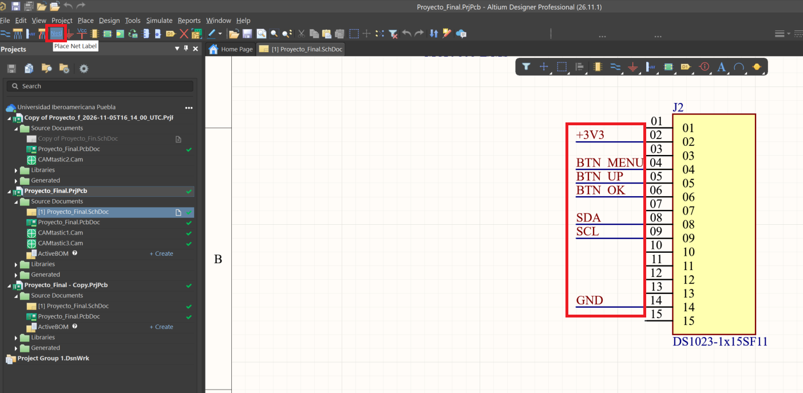

---

## Ports

Para diseños divididos en varias hojas puede utilizarse:

```text
Place → Port
```

Son especialmente útiles en diseños jerárquicos.

---

## Power Ports

Para alimentación utiliza:

```text
Place → Power Port
```

Ejemplos:

```text
GND
5V
3V3
12V
```

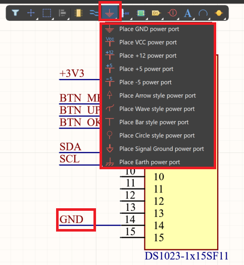

El nombre de la red es lo que determina la conexión eléctrica.

---

# 11. Organización visual del esquemático

Además de conexiones eléctricas pueden utilizarse:

- texto;
- líneas;
- rectángulos;
- elementos gráficos.

Estos sirven únicamente para organizar visualmente el circuito.

Una estructura recomendable es dividirlo en bloques:

```text
POWER
MICROCONTROLLER
INPUTS
OUTPUTS
SENSORS
COMMUNICATION
```

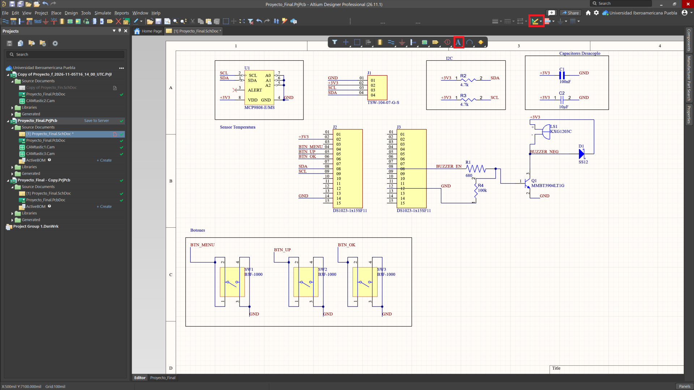

Siempre que sea posible mantén un flujo visual lógico:

```text
ENTRADAS → PROCESAMIENTO → SALIDAS
```

---

# 12. Designators y anotación

Antes de transferir el proyecto al PCB todos los componentes deben tener identificadores únicos.

Utiliza:

```text
Tools → Annotation → Annotate Schematics
```

Esto permite transformar:

```text
R? → R1
R? → R2
C? → C1
U? → U1
```

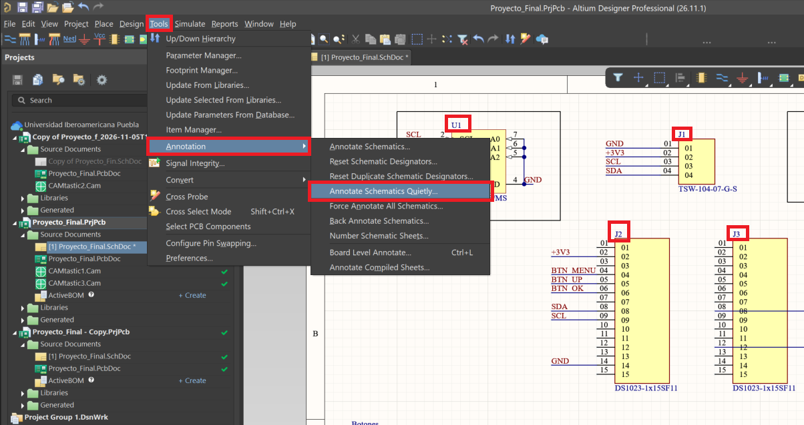

Comprueba que no existan designadores duplicados.

---

# 13. Validar el esquemático

Antes de crear el PCB ejecuta:

```text
Project → Validate PCB Project
```

Los errores y advertencias aparecen en:

```text
View → Panels → Messages
```

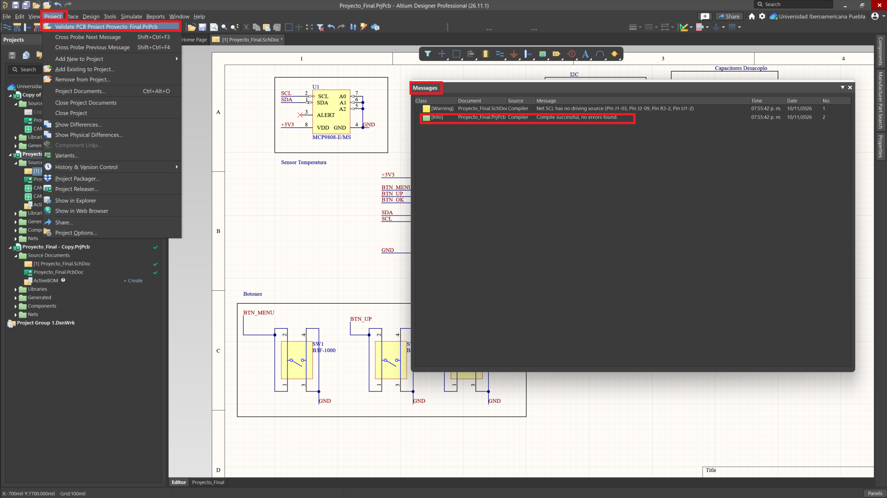

Revisa especialmente:

- conexiones incorrectas;
- pines sin conectar;
- conflictos eléctricos;
- designadores;
- componentes sin footprint.

No ignores errores sin comprender primero su causa.

---

# 14. Transferir el diseño al PCB

Con el esquemático terminado utiliza:

```text
Design → Update PCB Document
```

Altium abrirá el:

```text
Engineering Change Order
```

o:

```text
ECO
```

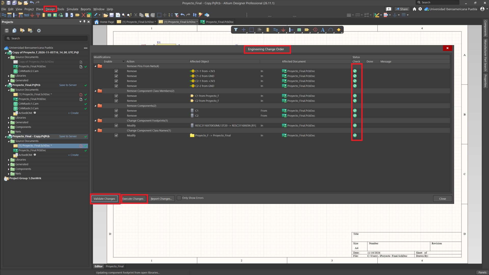

El flujo correcto es:

```text
Update PCB Document
        ↓
Validate Changes
        ↓
Execute Changes
```

Esto transferirá:

- componentes;
- footprints;
- Nets;
- conexiones.

Si un componente no puede transferirse, comprueba primero su footprint.

---

# 15. Vista general del PCB Editor

El `.PcbDoc` contiene el diseño físico.

Aquí encontraremos:

- componentes;
- pads;
- pistas;
- vias;
- polígonos;
- capas;
- Board Shape.

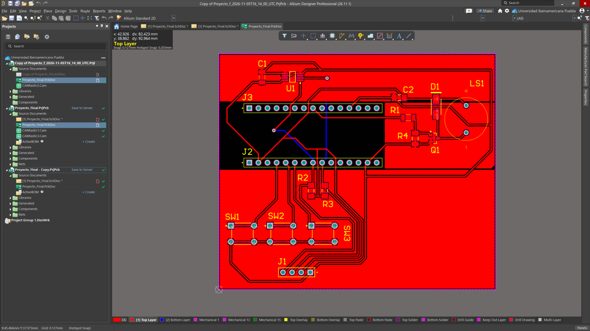

Los modos principales son:

```text
1 → Board Planning Mode
2 → 2D Layout Mode
3 → 3D Layout Mode
```

---

# 16. Board Shape, origen y Grid

## Board Shape

Define físicamente el tamaño de la PCB.

Puede redefinirse mediante:

```text
Design → Redefine Board Shape
```

Dibuja el perímetro real de la tarjeta.

---

## Origen

Es recomendable establecer un punto conocido como origen.

Utiliza:

```text
Edit → Origin → Set
```

Normalmente puede colocarse en una esquina de la tarjeta.

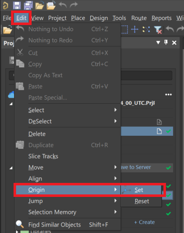

---

## Grid

Presiona:

```text
G
```

para cambiar rápidamente el Snap Grid.

Utiliza una cuadrícula suficientemente grande para organizar el diseño y reduce su tamaño únicamente cuando necesites ajustes más precisos.

---

# 17. Capas de la PCB

Las capas principales que debes conocer son:

| Capa | Función |
|---|---|
| `Top Layer` | Cobre superior |
| `Bottom Layer` | Cobre inferior |
| `Top Overlay` | Serigrafía superior |
| `Bottom Overlay` | Serigrafía inferior |
| `Top Solder` | Máscara superior |
| `Bottom Solder` | Máscara inferior |
| `Top Paste` | Pasta de soldadura superior |
| `Bottom Paste` | Pasta inferior |
| `Mechanical` | Información mecánica |
| `Keep-Out` | Zonas restringidas |

El panel principal para controlar su visualización es:

```text
View → Panels → View Configuration
```

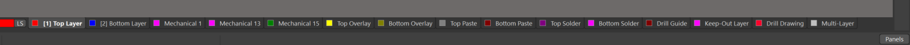

Para recorrer modos de visualización de una sola capa utiliza:

```text
Shift + S
```

---

# 18. Layer Stack Manager

La estructura física de las capas se configura en:

```text
Design → Layer Stack Manager
```
Para una PCB sencilla de dos capas normalmente tendremos:

```text
Top Copper
Dielectric
Bottom Copper
```

además de máscara y serigrafía.

En proyectos multicapa pueden añadirse capas internas.

La estructura utilizada debe ser compatible con el fabricante.

---

# 19. Placement de componentes

Después del ECO los componentes deben organizarse dentro del Board Shape.

Durante el placement utiliza las:

```text
Connection Lines
```

para observar qué componentes deben conectarse.

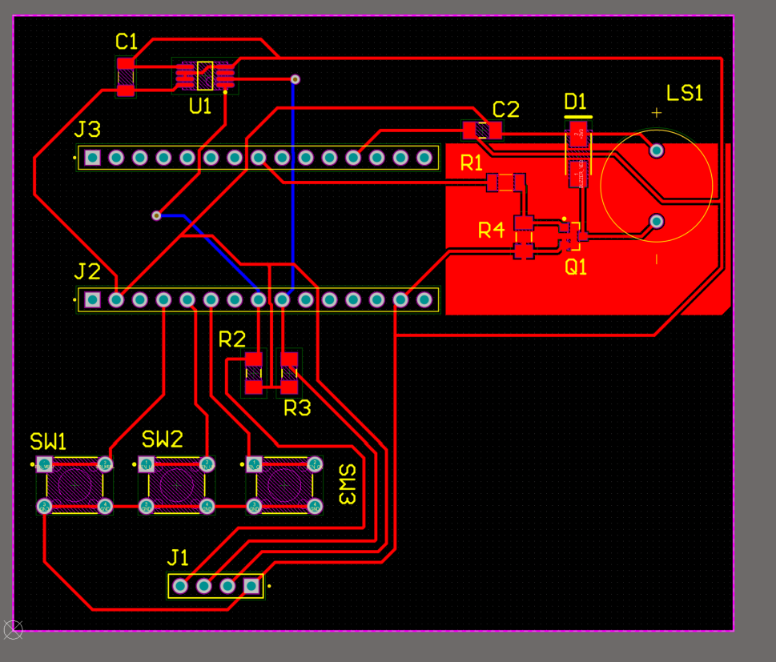

Orden recomendado:

1. conectores y componentes con posición mecánica fija;
2. circuitos principales;
3. componentes asociados;
4. capacitores de desacoplo cerca de sus pines;
5. componentes secundarios.

Mientras mueves un componente:

```text
Space → rotar
L → cambiar entre Top y Bottom
```

No comiences a rutear hasta tener un placement razonablemente organizado.

---

# 20. Reglas de diseño

Las reglas determinan restricciones como:

```text
Clearance
Track Width
Via Size
Hole Size
Component Clearance
```

Dependiendo del proyecto encontrarás:

```text
Design → Rules
```

o:

```text
Design → Constraint Manager
```

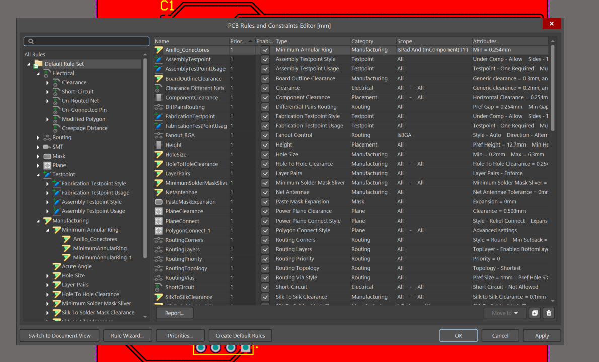

En Altium 26 algunos proyectos utilizan el nuevo `Constraint Manager`.

---

## Reglas esenciales

### Clearance

Separación mínima entre objetos eléctricos.

```text
Electrical → Clearance
```

---

### Width

Ancho permitido para las pistas.

```text
Routing → Width
```

Normalmente contiene:

```text
Minimum
Preferred
Maximum
```

---

### Via Style

Dimensiones de las vías.

```text
Routing Via Style
```

Incluye:

```text
Via Diameter
Hole Size
```

> [!IMPORTANT]
> Configura estos valores según las capacidades reales del fabricante.

---

# 21. Importar reglas

Si ya dispones de un archivo de reglas:

```text
*.rul
```

en proyectos que utilizan el editor tradicional:

1. abre:

```text
Design → Rules
```

2. haz clic derecho en el árbol de reglas;
3. selecciona:

```text
Import Rules
```

4. selecciona el archivo `.rul`;
5. importa las reglas necesarias;
6. revisa sus valores y prioridades.

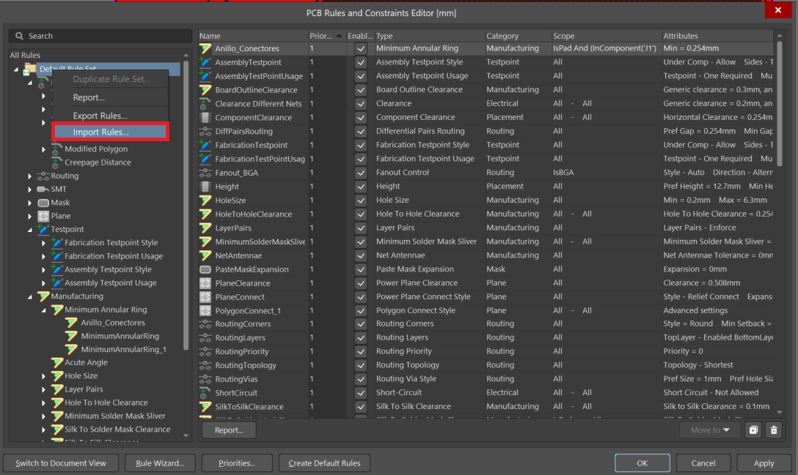

No utilices reglas importadas sin comprobar que correspondan con tu fabricante y proyecto.

---

# 22. Routing

Para crear físicamente las conexiones utiliza:

```text
Route → Interactive Routing
```

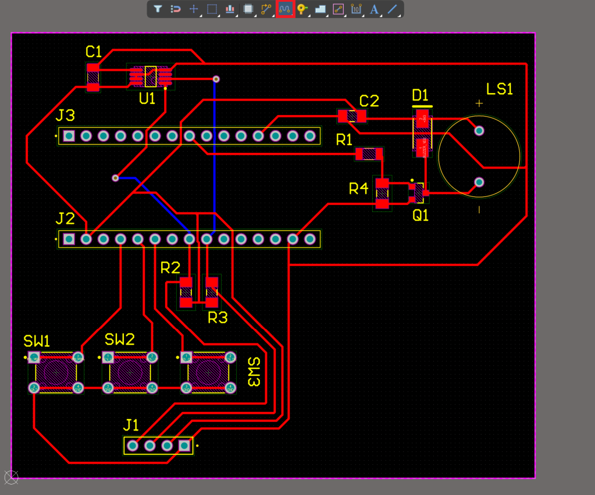

Procedimiento:

1. inicia Interactive Routing;
2. haz clic en un pad;
3. sigue la Connection Line;
4. coloca segmentos;
5. termina sobre el pad destino.

Una vez completada correctamente la conexión, la Connection Line desaparecerá.

---

## Herramientas durante Routing

```text
Shift + Space → cambiar estilo de esquina
Shift + R → cambiar modo de obstáculos
Tab → opciones de Routing
Backspace → eliminar último segmento
```

Los modos de resolución de obstáculos incluyen opciones como:

```text
Walkaround
Push
Ignore
```

Para comenzar resulta recomendable utilizar:

```text
Walkaround
```

---

# 23. Cambio de capa y vías

Cuando una pista debe pasar de:

```text
Top Layer
```

a:

```text
Bottom Layer
```

es necesario insertar una:

```text
Via
```

Durante Interactive Routing puedes cambiar a otra capa disponible y Altium insertará automáticamente una vía.

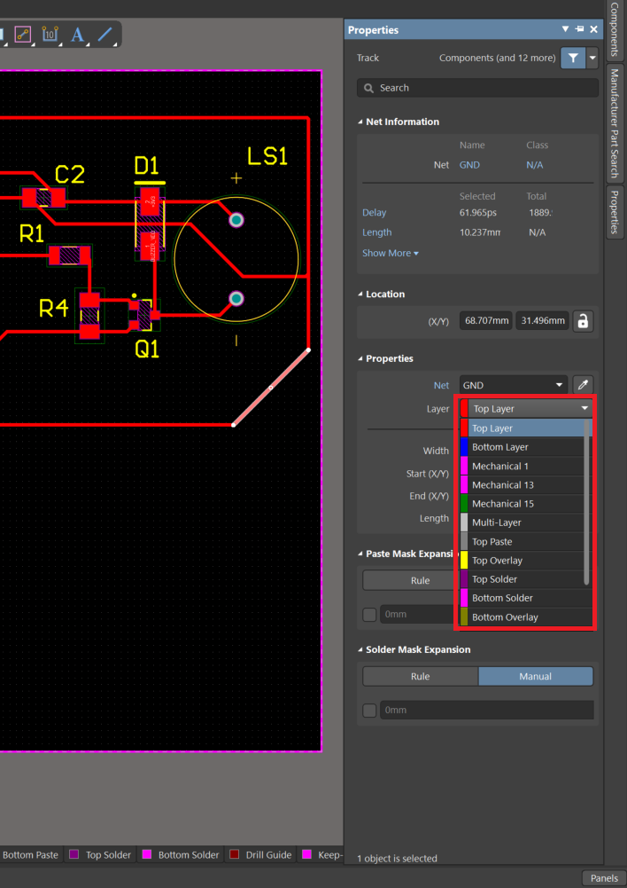

Una vía contiene principalmente:

```text
Diameter
Hole Size
```

y sus dimensiones deben cumplir las reglas del fabricante.

---

# 24. Polygon Pours y planos de GND

Un `Polygon Pour` permite crear grandes regiones de cobre.

Se utiliza habitualmente para:

```text
GND
```

Para crear uno:

```text
Place → Polygon Pour
```

1. selecciona la capa;
2. asigna:

```text
Net = GND
```

3. dibuja el perímetro;
4. finaliza el polígono.

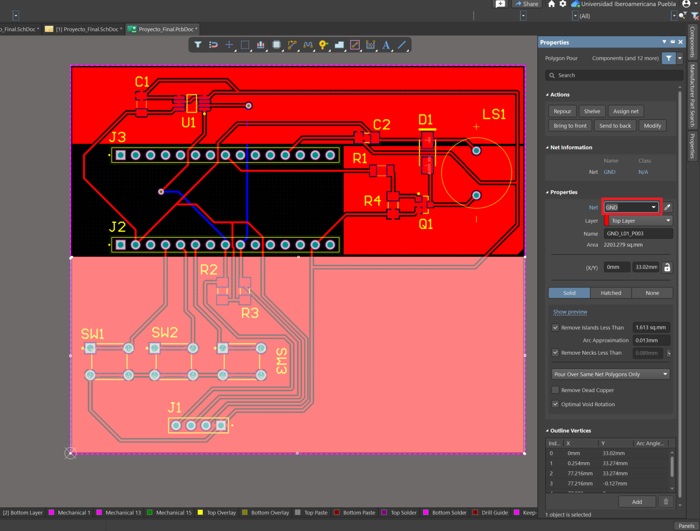

Después de modificar la PCB ejecuta:

```text
Tools → Polygon Pours → Repour All
```

para recalcular los polígonos.

Los polígonos respetarán automáticamente las reglas de Clearance.

---

# 25. Auto Route

Altium incluye:

```text
Route → Auto Route
```

para intentar rutear automáticamente el PCB.

Puede ser útil para experimentar o estudiar posibles rutas, pero no sustituye un buen placement ni una revisión manual.

Antes de utilizarlo deben estar correctamente configurados:

```text
Board Shape
Layers
Placement
Clearance
Width
Via Style
```

Para aprender diseño PCB es preferible comenzar utilizando **Interactive Routing manual**.

---

# 26. DRC y revisión final

Antes de fabricar ejecuta primero:

```text
Tools → Polygon Pours → Repour All
```

y después:

```text
Tools → Design Rule Check
```

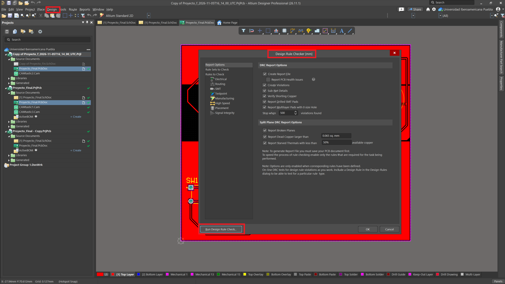

Ejecuta:

```text
Run Design Rule Check
```

Revisa los errores desde:

```text
View → Panels → PCB Rules And Violations
```

o desde:

```text
Messages
```

---

## Problemas comunes

### Clearance Constraint

Dos objetos están demasiado cerca.

### Width Constraint

Una pista utiliza un ancho fuera de las reglas.

### Short-Circuit Constraint

Dos Nets diferentes están eléctricamente conectadas.

### Un-Routed Net

Existe una conexión pendiente.

### Silk to Solder Mask

Texto o serigrafía demasiado cerca de un pad.

No reduzcas o desactives reglas únicamente para eliminar errores.

Corrige primero la causa.

---

# 27. Vista 3D

Para visualizar la PCB en tres dimensiones utiliza:

```text
3
```

Para volver a 2D:

```text
2
```

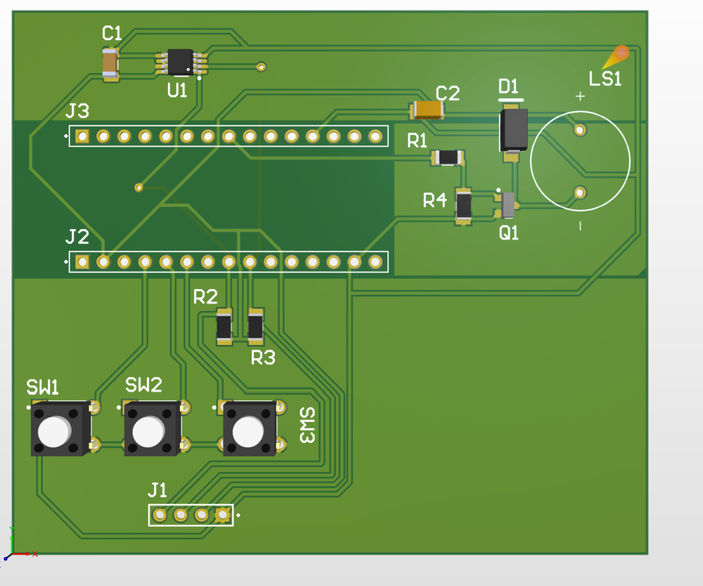

Utiliza esta vista para comprobar:

- orientación;
- conectores;
- alturas;
- componentes inferiores;
- agujeros;
- interferencias mecánicas.

Un componente puede funcionar correctamente en el PCB aunque no tenga modelo 3D, pero no podrás realizar una revisión mecánica completa.

---

# 28. Gerber y archivos de perforación

Una vez que:

```text
DRC = correcto
```

y la PCB ha sido revisada, pueden generarse los archivos de fabricación.

---

## Gerber

Utiliza:

```text
File → Fabrication Outputs → Gerber Files
```

o:

```text
File → Fabrication Outputs → Gerber X2 Files
```

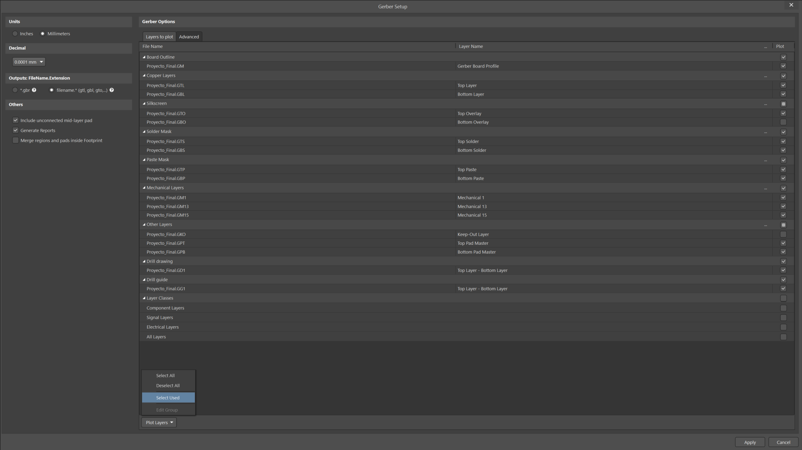

Para una PCB típica de dos capas normalmente se generan:

```text
Top Copper
Bottom Copper
Top Solder
Bottom Solder
Top Overlay
Bottom Overlay
Board Outline
```

Las capas:

```text
Top Paste
Bottom Paste
```

se utilizan principalmente para fabricar stencils de ensamblaje SMD.

Consulta siempre qué formato solicita el fabricante.

---

## NC Drill

Los archivos de perforación se generan mediante:

```text
File → Fabrication Outputs → NC Drill Files
```

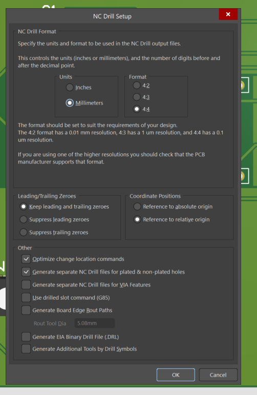

Incluyen información sobre:

- vias;
- pads through-hole;
- mounting holes;
- perforaciones.

Comprueba que Gerber y NC Drill utilicen:

- unidades compatibles;
- misma referencia de coordenadas;
- mismo origen.

---

## Output Job

Para proyectos que generarás varias veces es recomendable utilizar un:

```text
*.OutJob
```

y centralizar dentro de él:

```text
Gerber
NC Drill
DRC
```

Esto evita tener que configurar las salidas manualmente cada vez.

---

## Verificar antes de enviar

Después de generar los archivos abre los Gerbers y archivos de perforación en un visor CAM.

Comprueba:

```text
cobre
máscara
serigrafía
contorno
agujeros
```

especialmente que los taladros coincidan exactamente con pads y vías.

---

# 29. Flujo general recomendado

El proceso esencial de trabajo en Altium puede resumirse como:

```text
CREAR PROYECTO
      ↓
CREAR ESQUEMÁTICO
      ↓
IMPORTAR LIBRERÍAS NECESARIAS
      ↓
COLOCAR COMPONENTES
      ↓
CONECTAR CON WIRES
      ↓
NET LABELS / POWER PORTS
      ↓
ANOTAR COMPONENTES
      ↓
VALIDATE PCB PROJECT
      ↓
COMPROBAR FOOTPRINTS
      ↓
UPDATE PCB DOCUMENT
      ↓
VALIDATE CHANGES
      ↓
EXECUTE CHANGES
      ↓
DEFINIR BOARD SHAPE
      ↓
CONFIGURAR GRID Y CAPAS
      ↓
CONFIGURAR / IMPORTAR RULES
      ↓
PLACEMENT
      ↓
INTERACTIVE ROUTING
      ↓
VIAS
      ↓
POLYGON POUR GND
      ↓
REPOUR ALL
      ↓
DRC
      ↓
REVISIÓN 2D / 3D
      ↓
GENERAR GERBER
      ↓
GENERAR NC DRILL
      ↓
VERIFICAR ARCHIVOS
      ↓
FABRICAR
```

---

# Herramientas y atajos que conviene recordar

| Herramienta | Acción |
|---|---|
| `Esc` | Cancelar o salir de una herramienta |
| `Tab` | Modificar propiedades durante una operación |
| `Space` | Rotar objeto |
| `G` | Cambiar Grid |
| `Q` | Cambiar unidades mm/mil en PCB |
| `1` | Board Planning Mode |
| `2` | 2D PCB Mode |
| `3` | 3D PCB Mode |
| `Shift + S` | Single Layer Mode |
| `Shift + Space` | Cambiar estilo de esquina durante Routing |
| `Shift + R` | Cambiar modo de resolución de obstáculos |
| `Backspace` | Eliminar último segmento durante Routing |
| `L` | Cambiar componente entre Top y Bottom durante movimiento |

---

# Herramientas principales que debes conocer

## Esquemático

```text
Components
Properties
Wire
Net Label
Port
Power Port
Annotate Schematics
Validate PCB Project
Messages
```

## PCB

```text
Update PCB Document
Engineering Change Order
Board Shape
Origin
Grid
View Configuration
Layer Stack Manager
Design Rules / Constraint Manager
Interactive Routing
Via
Polygon Pour
Repour All
Design Rule Check
3D View
```

## Fabricación

```text
Gerber
Gerber X2
NC Drill
OutJob
CAM Viewer
```

Conocer estas herramientas y comprender cómo se relacionan entre sí es suficiente para desarrollar la mayor parte de los proyectos PCB básicos e intermedios en Altium Designer.
