# Guía  de Inicio Rápido: Manual Completo de Uso y Simulación en NI Multisim

Bienvenido a esta guía sobre el uso de **Multisim** para el diseño, simulación y validación de circuitos electrónicos analógicos, digitales y mixtos. Este documento está diseñado para guiarte desde los conceptos fundamentales de la interfaz hasta la instrumentación virtual de laboratorio.

---

## Contenido
- [1. Entorno General y Configuración de la Interfaz](#1-entorno-general-y-configuración-de-la-interfaz)
- [2. Simulación de Lógica Digital y Compuertas TTL Paso a Paso](#2-simulación-de-lógica-digital-y-compuertas-ttl-paso-a-paso)
- [3. Gestión Avanzada de Nodos, Etiquetas de Red e Indicadores](#3-gestión-avanzada-de-nodos-etiquetas-de-red-e-indicadores)
- [4. El Convertidor Lógico (Logic Converter) a Detalle](#4-el-convertidor-lógico-logic-converter-a-detalle)
- [5. Motores de Análisis y Simulación Avanzada (Transitorio, DC Sweep y Temperatura)](#5-motores-de-análisis-y-simulación-avanzada-transitorio-dc-sweep-y-temperatura)
- [6. Instrumentación Virtual de Laboratorio: Generadores y Osciloscopios](#6-instrumentación-virtual-de-laboratorio-generadores-y-osciloscopios)

---

## 1. Entorno General y Configuración de la Interfaz

### Distribución del Espacio de Trabajo
Al cargar el software, te encontrarás con una interfaz dividida en cuatro áreas operativas clave:

* **Lienzo de Diseño Esquemático (Worksheet):** Corresponde al área central cuadriculada. Aquí se colocan los componentes físicos y lógicos, se trazan las líneas de conexión eléctrica y se conectan las referencias a tierra.
* **Barra de Menús y Herramientas Superiores:** Ubicada en la parte alta de la pantalla. Proporciona acceso a la gestión de archivos (`File`), edición (`Edit`), opciones de visualización (`View`), colocación de elementos (`Place`), configuración de simulación (`Simulate`) y ventanas emergentes (`Window`).
* **Barra de Selección de Componentes:** Posicionada justo debajo de la barra de menús. Agrupa los dispositivos electrónicos en familias lógicas y analógicas mediante botones de acceso rápido:
  - **Place Source:** Fuentes de alimentación CA, CC y señales digitales.
  - **Place Basic:** Resistencias, capacitores, inductores y switches.
  - **Place Diodes:** Diodos rectificadores, Zener y LEDs.
  - **Place Transistors:** Transistores BJT (NPN/PNP), MOSFETs y JFETs.
  - **Place Analog:** Amplificadores operacionales y comparadores.
  - **Place TTL:** Circuitos integrados digitales de la familia 7400.
* **Barra Lateral Derecha (Instrumentos Virtuales):** Un banco de medición interactivo que incluye multímetros digitales, generadores de funciones, wattímetros, osciloscopios de dos y cuatro canales, trazadores de Bode, frecuencímetros y el convertidor lógico.

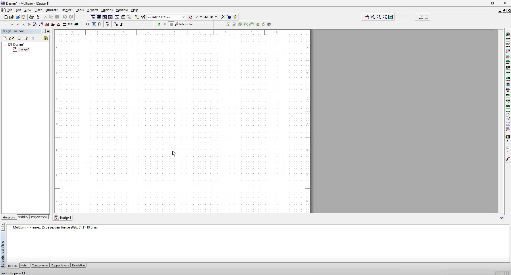

---

## 2. Simulación de Lógica Digital y Compuertas TTL

El diseño de sistemas digitales dentro de Multisim permite evaluar funciones booleanas mediante componentes estándar de tecnología **TTL** (*Transistor-Transistor Logic*).

### Búsqueda e Inserción de Compuertas Lógicas
1. Dirígete a la barra superior de componentes y haz clic en el botón **Place TTL** (o presiona la combinación de teclas `Ctrl + W` y selecciona el grupo `TTL`).
2. Se desplegará la ventana emergente **Select a Component** (Seleccionar Componente).
3. En la esquina superior izquierda, dentro del desplegable **Family**, selecciona la subfamilia correspondiente (por ejemplo, `74LS` para tecnología Low-Power Schottky).
4. En el cuadro de texto **Component**, escribe la matrícula específica del circuito integrado:
   - Para compuertas **AND** de dos entradas: Escribe `74LS08`.
   - Para compuertas **OR** de dos entradas: Escribe `74LS32`.
   - Para compuertas **NOT** (Inversores): Escribe `74LS04`.

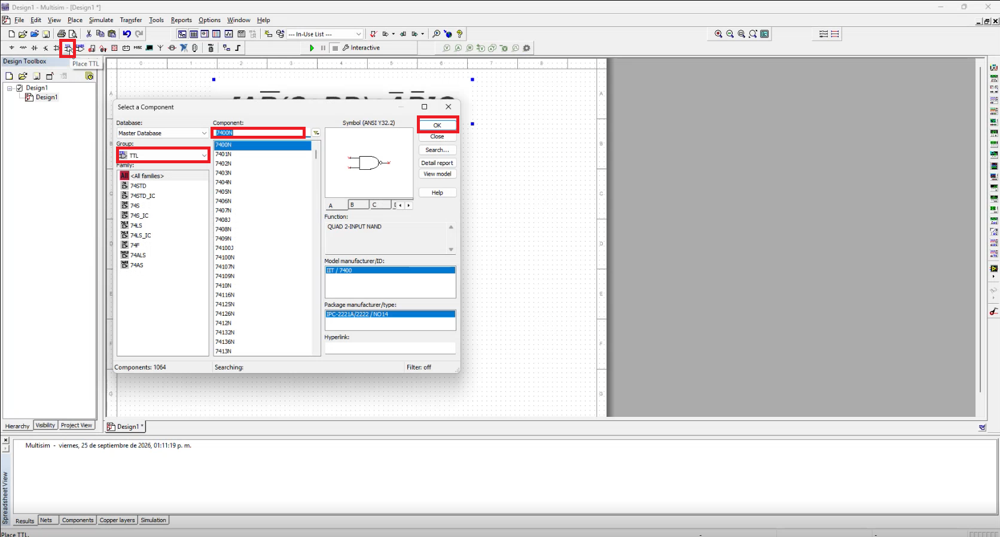

### Entendiendo las Sub-compuertas (`A`, `B`, `C`, `D`)
Al hacer clic en **OK** para colocar un componente como el `74LS08`, notarás que la ventana no se cierra inmediatamente, sino que te muestra una pequeña sub-lista con las letras `A`, `B`, `C` y `D`:

>  **Explicación técnica de la estructura física del CI:**
> Un circuito integrado real de 14 pines (como el `74LS08`) alberga internamente 4 compuertas AND independientes que comparten las mismas terminales de alimentación (VCC y GND). 
> * Al seleccionar `A`, Multisim colocará la primera compuerta del chip (pines 1, 2 y 3).
> * Si vuelves a colocar otra compuerta del mismo grupo y seleccionas `B`, el programa entenderá que estás utilizando la segunda compuerta dentro del **mismo chip físico** (designado como `U1B`).
> * Si requieres que pertenezcan a circuitos integrados independientes, debes seleccionar la opción para iniciar un nuevo encapsulado (generando un nuevo identificador como `U2A`).

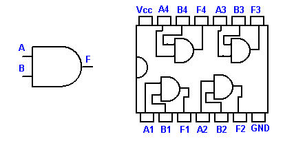

### Configuración de Fuentes Digitales Interactivas
Para simular las entradas de una tabla de verdad e inyectar estados lógicos bajo demanda sin armar un circuito con switches de hardware y resistencias de *pull-down*:

1. En la barra de componentes, haz clic en el icono **Place Source** (o `Ctrl + W` > Grupo `Sources`).
2. En la columna de la izquierda, selecciona la categoría **DIGITAL_SOURCES**.
3. En la lista de componentes, haz clic sobre **INTERACTIVE_DIGITAL_CONSTANT**.
4. Haz clic en **OK** y coloca tantas fuentes interactivas como entradas tenga tu función booleana (por ejemplo, cuatro fuentes para las entradas A, B, C y D).
5. Por defecto, cada fuente interactiva muestra una tecla de acceso rápido (como `Space`). Si deseas cambiar la tecla que conmuta la señal de 0 V a 5 V, haz doble clic sobre el componente, ve a la pestaña **Value** y asigna una tecla específica del teclado (por ejemplo, la tecla `A` para la entrada A).

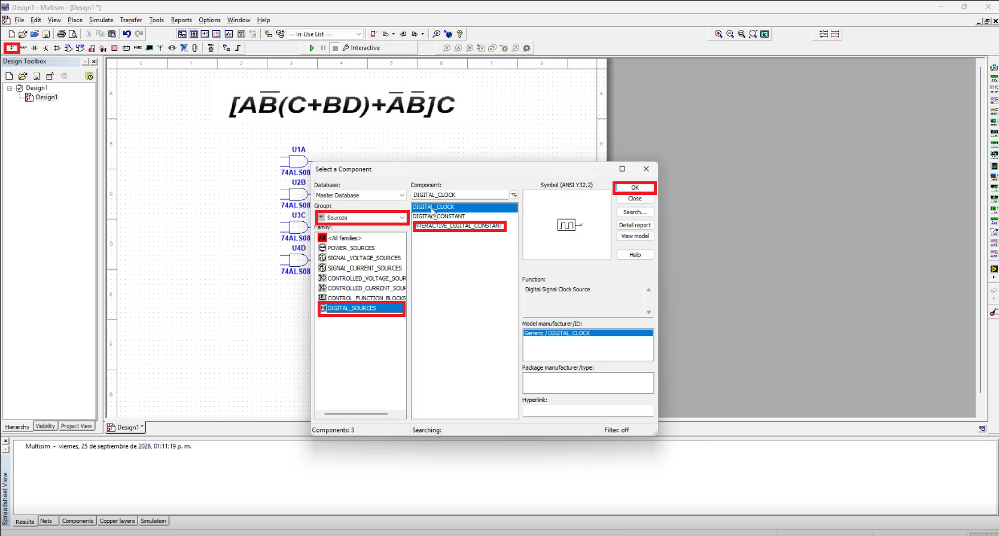

---

## 3. Gestión Avanzada de Nodos, Etiquetas de Red e Indicadores

Para mantener un esquemático limpio, legible y profesional, Multisim permite conectar pines distantes mediante etiquetas de red (nodos virtuales), evitando cruces innecesarios de líneas.

### Pasos para Crear y Nombrar Etiquetas de Red (Nodos)
1. Coloca el cursor sobre la terminal de salida de una fuente interactiva o pin de una compuerta. Observa cómo el puntero cambia de una flecha a una cruz de conexión.
2. Haz clic izquierdo y arrastra un pequeño segmento de cable de 1 a 2 cm hacia la derecha. Haz doble clic en el aire para fijar el extremo libre de la línea.
3. Haz **doble clic** sobre el cable recién trazado (el cual tomará un color rojo por defecto).
4. Se abrirá la ventana emergente de propiedades de la red (**Net Properties**).
5. En el campo de texto **Net name**, escribe el identificador de la señal (por ejemplo, `A`).
6. En la sección inferior, asegúrate de marcar la casilla **Show net name** (Mostrar nombre de red) y haz clic en **Aceptar**.
7. Ahora, dirígete a la entrada de la compuerta lógica donde debe llegar esa señal, traza un pequeño segmento de cable y haz doble clic sobre él. Renómbralo con exactamente el mismo texto (`A`).
8. Al presionar **Aceptar**, Multisim desplegará un cuadro de diálogo notificando que la red `A` ya existe y preguntará si deseas unir ambos segmentos. Haz clic en **Yes**. Ambos puntos quedarán unidos eléctricamente sin necesidad de trazar una línea continua entre ellos.

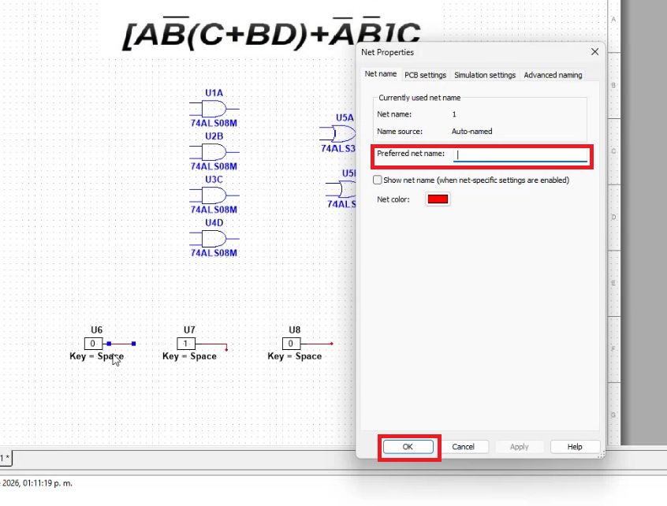

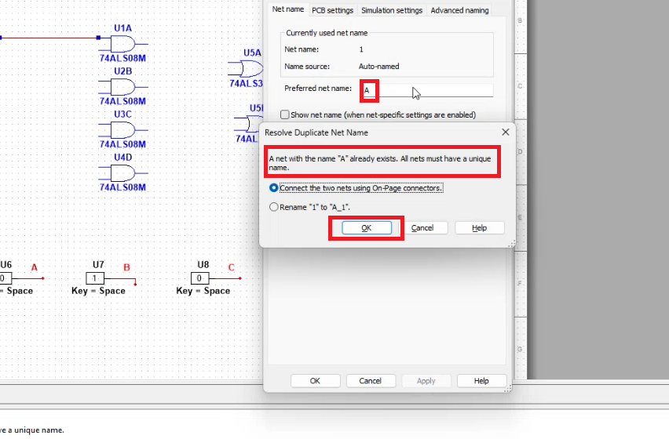

### Uso de Puntas de Prueba Lógicas (*Probes*)
Para verificar las salidas lógicas sin agregar un circuito físico con diodos LED, resistencia limitadora y tierra:

1. Dirígete a la barra superior y busca el icono de **Place Indicator** (el cual tiene forma de display de 7 segmentos).
2. Selecciona la categoría **PROBE**.
3. Elige el color del indicador visual (`PROBE_DIGITAL_RED`, `PROBE_DIGITAL_GREEN`, `PROBE_DIGITAL_BLUE`, etc.) y haz clic en **OK**.
4. Conecta el terminal de la punta de prueba directamente al nodo o pin de salida de tu última compuerta lógica.
5. Al iniciar la simulación (`F5` o botón verde **Play**), la punta se iluminará intensamente cuando la combinación lógica entregue un nivel alto (5 V) y permanecerá apagada en nivel bajo (0 V).

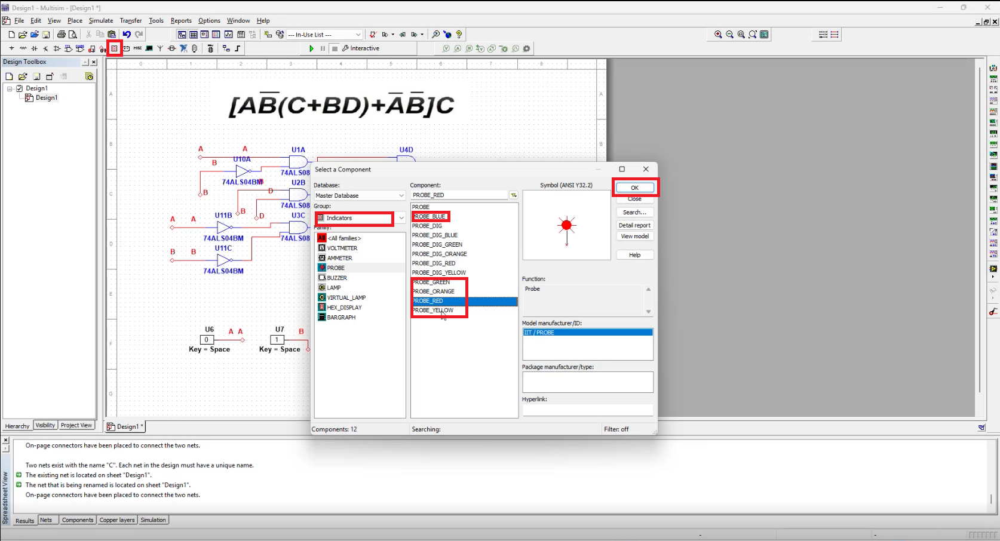

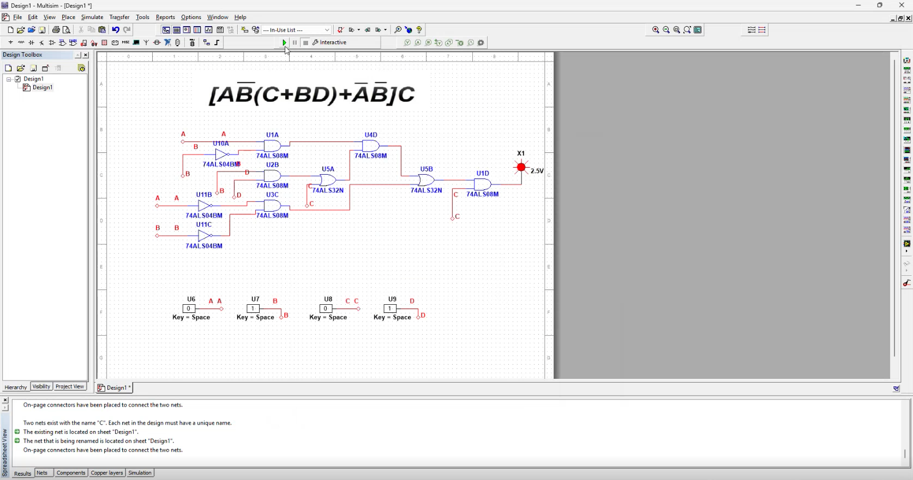

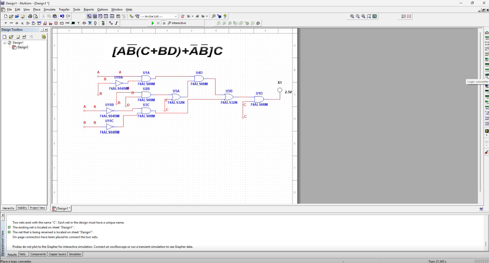

---

## 4. El Convertidor Lógico (Logic Converter) a Detalle

El **Convertidor Lógico** es uno de los instrumentos virtuales más potentes y versátiles integrados en Multisim. Su propósito principal es servir como un puente matemático automatizado capaz de interconectar tablas de verdad, expresiones algebraicas booleanas y diagramas esquemáticos en cuestión de segundos.

### Configuración de Conexiones del Instrumento
1. Dirígete a la barra lateral derecha de instrumentos virtuales y haz clic sobre el icono del **Logic Converter** (identificado visualmente con una compuerta y una pequeña matriz de ceros y unos). Colócalo en una sección despejada del lienzo de trabajo.
2. **Terminales de Entrada (A, B, C, etc.):** Debes conectar estas terminales desde la parte superior izquierda del instrumento hacia las líneas o nodos de entrada de tu circuito lógico. Es una buena práctica respetar el orden alfabético, conectando el bit más significativo (MSB) en la entrada superior y descendiendo secuencialmente hasta el bit menos significativo (LSB).
3. **Terminal de Salida (`S`):** Conecta esta terminal (ubicada en la parte derecha del instrumento) directamente hacia la salida o nodo principal de tu red lógica.

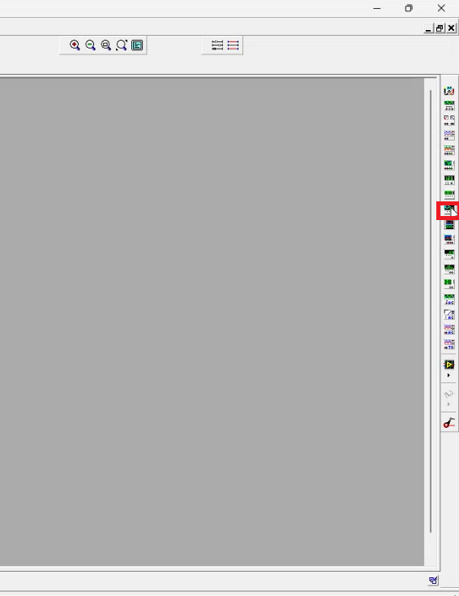

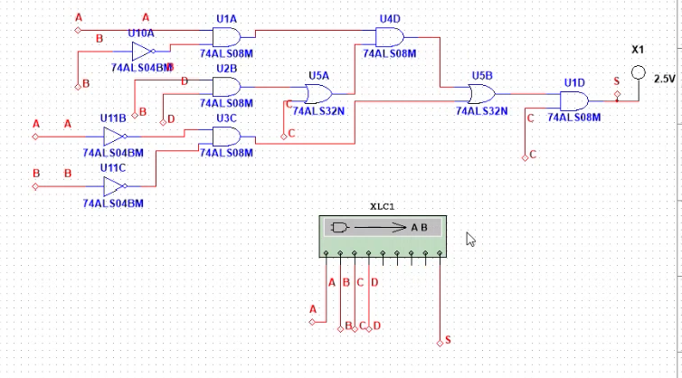

### Operación Interactiva del Panel de Control
Haz **doble clic** sobre el icono del instrumento en el esquemático para desplegar su ventana de control flotante. En su interfaz encontrarás un panel izquierdo con la tabla de verdad y una botonera inferior de conversión directa:

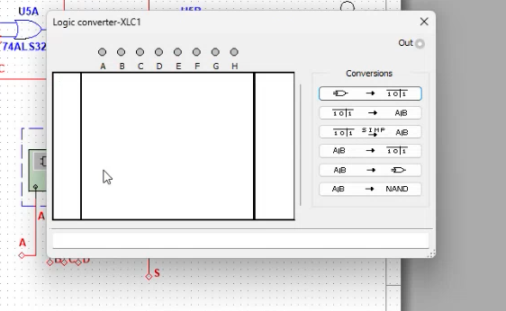

* **Extracción de la Tabla de Verdad desde el Esquema (`Circuito -> Tabla`):** Si ya terminaste de cablear un circuito digital en el lienzo y deseas comprobar su comportamiento matemático, haz clic en este primer botón (representado por una flecha que va de un circuito hacia una matriz). El instrumento simulará automáticamente todas las combinaciones posibles de las entradas y rellenará la tabla con los estados binarios de salida correspondientes.
* 
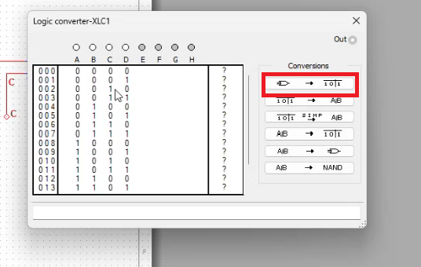
  
* **Simplificación y Obtención de la Función Booleana (`Tabla -> Función`):** Si introduces ceros y unos de forma manual en la tabla de verdad (haciendo clic sobre las celdas), o si el instrumento acaba de leer tu circuito, haz clic en el segundo botón. Multisim resolverá el mapa algebraico y te arrojará la función booleana simplificada en formato de suma de productos (minitérminos) de forma instantánea.

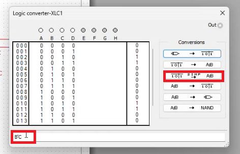
  
* **Síntesis Automática de Esquemáticos (De Función o Tabla a Circuito):** En la sección superior del panel puedes escribir directamente una expresión algebraica booleana utilizando operadores lógicos estándar. Al hacer clic en los botones de conversión hacia el esquemático, el programa generará automáticamente todas las compuertas y conexiones necesarias y las dibujará por ti en una nueva hoja de trabajo.

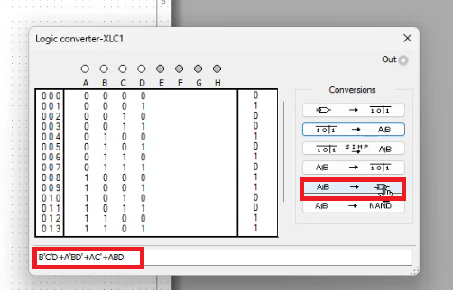

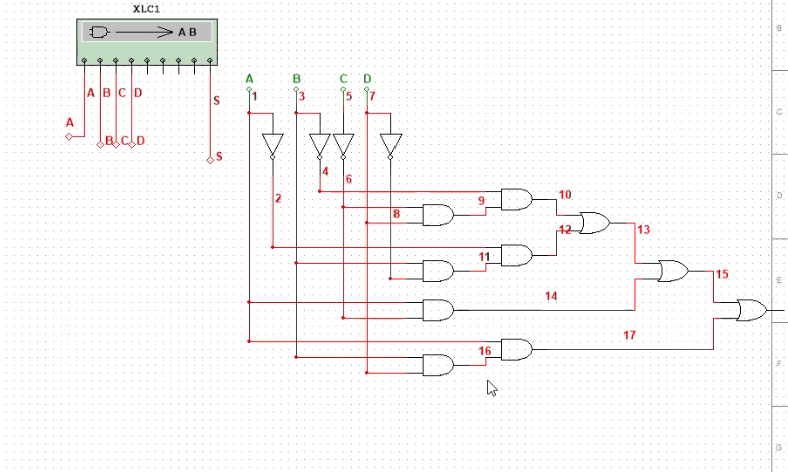

---

## 5. Motores de Análisis y Simulación Avanzada (Transitorio, DC Sweep y Temperatura)

Además de la simulación interactiva en tiempo real, Multisim integra potentes motores matemáticos basados en algoritmos SPICE para realizar análisis físicos y eléctricos especializados en componentes analógicos y semiconductores.

### Ruta de Acceso a los Motores de Análisis
Para configurar cualquiera de estas pruebas avanzadas, dirígete a la barra de menús superior, haz clic en **Simulate** y selecciona la opción **Analyses and Simulation** (o presiona la combinación de teclas correspondiente si está configurada). Se abrirá un menú principal con pestañas desplegables para cada tipo de estudio.

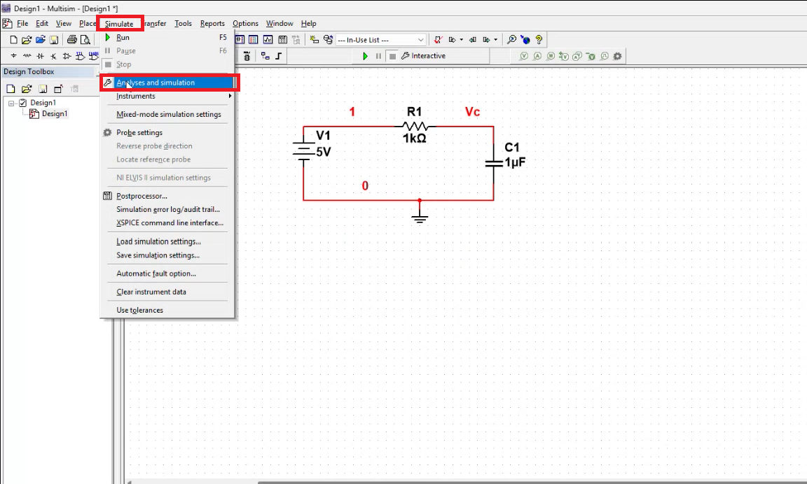

### 1. Análisis Transitorio (*Transient Analysis*)
* **Propósito y Aplicación:** Estudia cómo evolucionan las variables del circuito (voltajes y corrientes) en función del tiempo real. Es el análisis fundamental para observar fenómenos dinámicos y transitorios, tales como los procesos de carga y descarga exponencial en capacitores e inductores, o el comportamiento temporal de circuitos osciladores y fuentes conmutadas.
* **Pasos de Configuración:**
  1. En la ventana de análisis, selecciona la pestaña **Transient**.
     
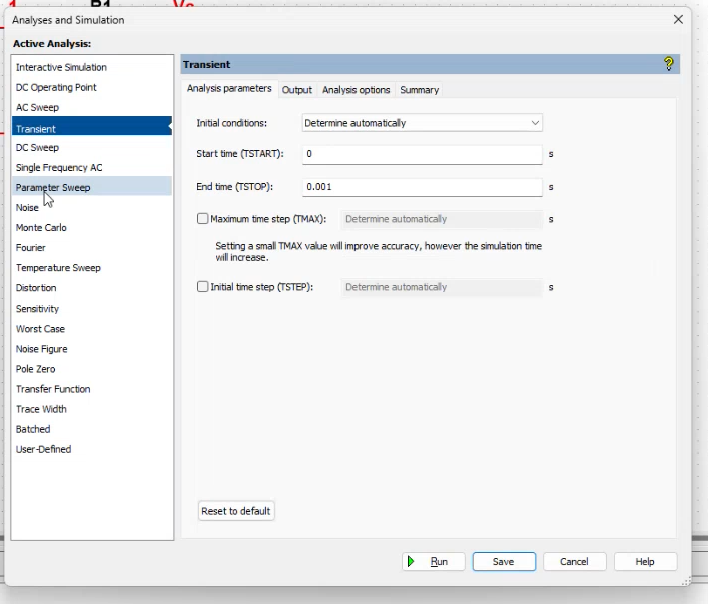
  
  2. En el apartado de parámetros temporales, define el tiempo inicial (**Start time**, normalmente configurado en `0 s`) y el tiempo de parada (**Stop time**, por ejemplo, `5 ms` o `1 s` dependiendo de la constante de tiempo τ = RC de tu circuito).

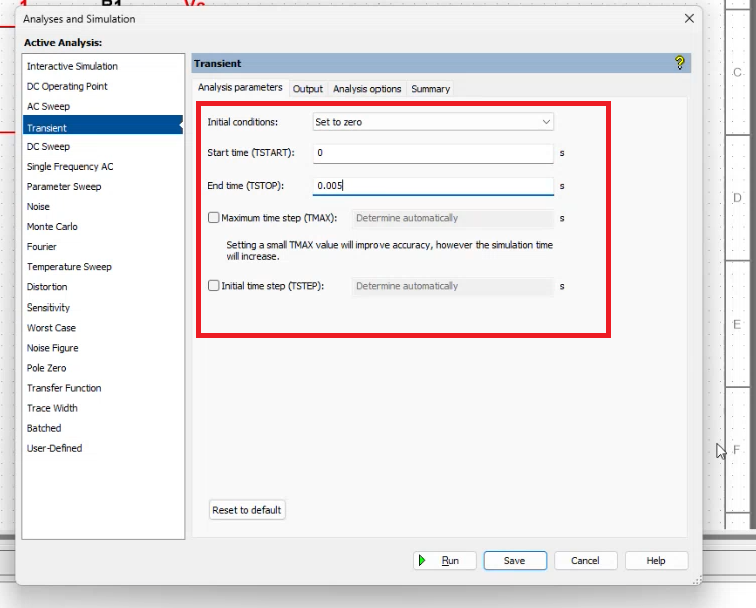
     
  3. En la sección de condiciones iniciales, puedes optar por calcular el punto de operación de polarización automática (**Automatically determine initial conditions**).
  4. Dirígete a la pestaña **Output** (Salida) en la misma ventana, busca en la lista de variables del circuito el nodo o componente que deseas medir (por ejemplo, el voltaje en las terminales del capacitor `V(capacitor)`) y haz clic en el botón **Add** para pasarlo a las variables activas a graficar.

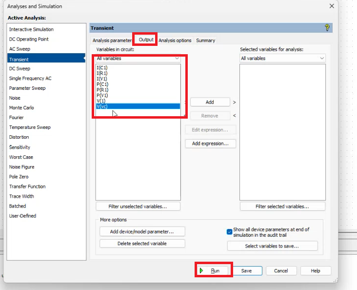

  5. Haz clic en el botón **Simulate** (o **Run**) ubicado en la parte inferior derecha de la ventana para desplegar la gráfica de respuesta temporal.
     
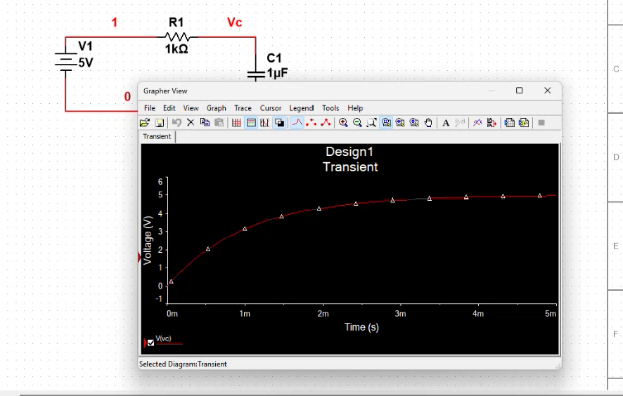

### 2. Análisis de Barrido DC (*DC Sweep Analysis*)
* **Propósito y Aplicación:** Realiza variaciones incrementales de voltaje o corriente punto a punto en condiciones de estado estacionario. Es la herramienta estándar en electrónica analógica para caracterizar dispositivos semiconductores no lineales, como la obtención de las curvas características de salida de un transistor bipolar (BJT en configuración de emisor común), relacionando el voltaje colector-emisor (VCE) frente a la corriente de colector (IC) ante distintos escalones de corriente de base (IB).
* **Pasos de Configuración:**
  1. Coloca un transistor (como el modelo clásico `2N2222`) y asegúrate de conectar fuentes de alimentación independientes en la base y en el colector.
  2. Abre el menú **Analyses and Simulation** y selecciona la pestaña **DC Sweep**.
     
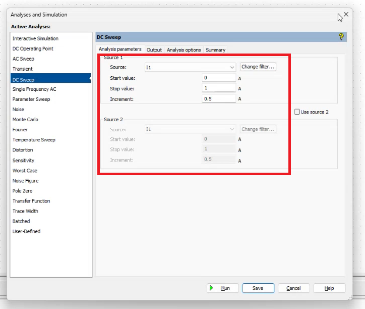

  2. Define la fuente principal de barrido (**Primary source**) que fungirá como el eje X de tu gráfica (por ejemplo, la fuente de voltaje del colector, nombrada como `VCE`). Establece el valor inicial, el valor final y el tamaño del incremento de paso (**Voltage step**).
  3. Si deseas generar una familia de curvas múltiples, habilita la opción de fuente secundaria (**Secondary source**), selecciona la fuente de la base (`IB`) y configura sus valores de incremento escalonado.
  4. En la pestaña **Output**, selecciona la variable dependiente de salida (por ejemplo, la corriente que atraviesa el pin de colector del transistor, `I(Q1)`) y haz clic en **Add**.
     
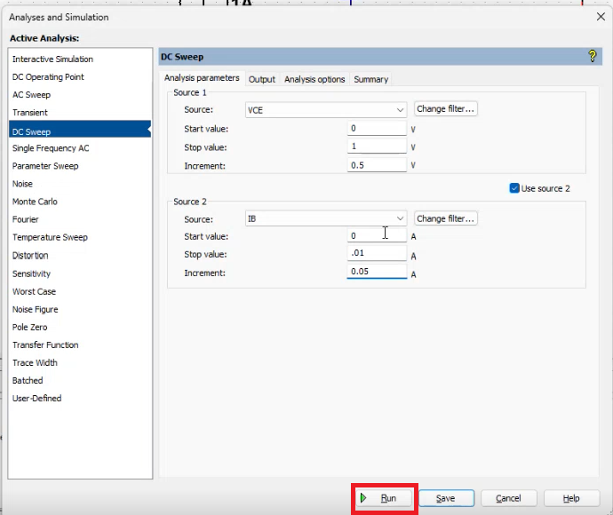

  5. Presiona **Simulate** para trazar la familia de curvas características.

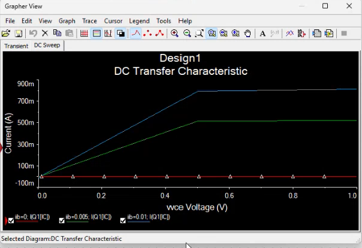

### 3. Análisis de Temperatura (*Temperature Analysis*)
* **Propósito y Aplicación:** Permite evaluar la estabilidad térmica y la sensibilidad de un circuito ante variaciones drásticas en la temperatura ambiental o de operación de los componentes. Es indispensable en diseños industriales, automotrices o aeroespaciales donde los transistores y diodos sufren derivas en sus parámetros físicos por calentamiento.
* **Pasos de Configuración:**
  1. Selecciona la pestaña **Temperature Analysis** dentro del menú de simulaciones avanzadas.
     
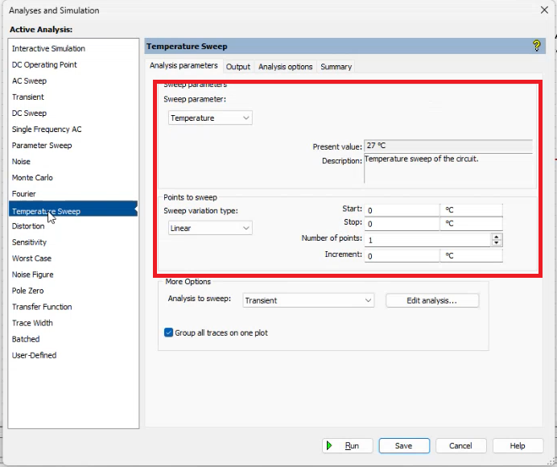

  2. Configura el rango térmico de estudio especificando la temperatura inicial y la temperatura final en grados centígrados (por ejemplo, desde los 0 °C hasta los 150 °C) junto con el número de puntos de muestreo o incremento lineal.
  3. Vincula este análisis a una simulación transitoria o de barrido DC para observar cómo se desplazan o deforman las curvas características del circuito conforme aumenta la temperatura de los semiconductores.

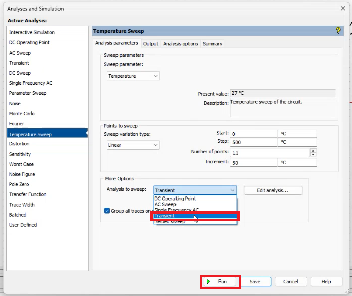

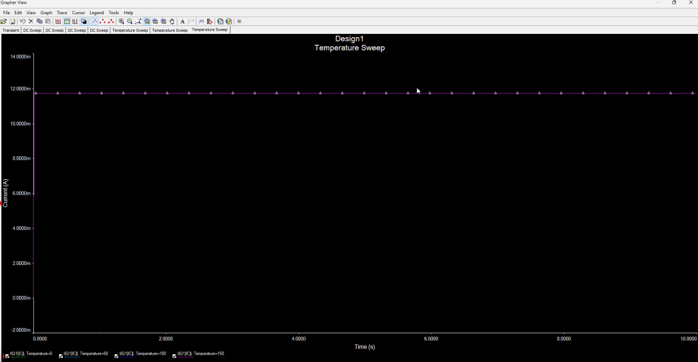
---

## 6. Instrumentación Virtual de Laboratorio: Generadores y Osciloscopios

Para el diseño, medición, filtrado y validación de circuitos analógicos que operan con corriente alterna, señales periódicas o transductores, Multisim ofrece un banco de instrumentos virtuales de laboratorio con interfaces hiperrealistas.

### El Generador de Funciones (*Function Generator*)
El generador de funciones es el instrumento encargado de inyectar señales de estímulo de CA personalizables hacia nuestro circuito:

* **Ubicación y Colocación:** Dirígete a la barra lateral derecha de instrumentos virtuales y haz clic sobre el icono del **Function Generator**. Colócalo en el lienzo de trabajo.
* **Terminales de Conexión:**
  - **Terminal Positiva (`+`):** Suministra la señal de salida respecto a la referencia de tierra.
  - **Terminal Negativa (`-`):** Suministra la señal con una inversión de fase de 180 grados.
  - **Terminal Común (`COM`):** Referencia central de tierra del generador.
* **Ajuste de Parámetros en el Panel de Control:** Haz doble clic sobre el icono del generador para abrir su carátula virtual. Desde aquí podrás configurar:
  - **Forma de onda:** Selecciona entre onda senoidal (pura para pruebas de audio y CA), triangular (para rampas de barrido) o cuadrada (para pulsos y modulación).
  - **Frecuencia (Frequency):** Define el valor numérico y la unidad de medida (Hertz, kHz o MHz) mediante el selector flotante o cuadro de texto.
  - **Amplitud (Amplitude):** Configura la amplitud pico-pico (Vpp), pico (Vp) o valor eficaz (VRMS).
  - **Offset de CD:** Permite desplazar el nivel de continua de la señal hacia arriba o hacia abajo respecto al eje de cero voltios.

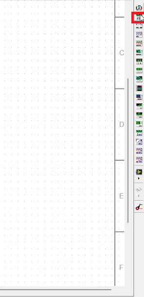

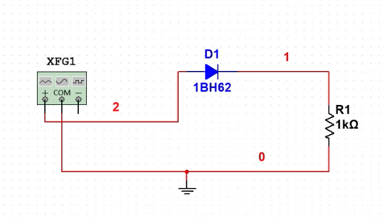

#### Inyección de Señales Personalizadas mediante Archivos Externos
Además de las ondas periódicas estándar, Multisim permite utilizar fuentes controladas (*Piecewise Linear Sources* o fuentes de voltaje por archivos de datos) para reproducir señales complejas del mundo real (por ejemplo, electrocardiogramas biomédicos, pulsos de sensores automotrices o transitorios de motores). Basta con cargar un archivo de texto con pares de datos de tiempo y voltaje (`t, V`) para que la fuente reproduzca el perfil dinámico de la señal sobre tu circuito.

---

### El Osciloscopio Virtual y la Configuración de Canales
Para analizar la respuesta en el tiempo, formas de onda y efectos de semiconductores (como la rectificación mediante diodos), se utiliza el osciloscopio:

* **Selección del Instrumento:** Puedes seleccionar el osciloscopio estándar de dos canales, el osciloscopio de cuatro canales, o réplicas de instrumentos comerciales de laboratorio como el **Osciloscopio Tektronix**.

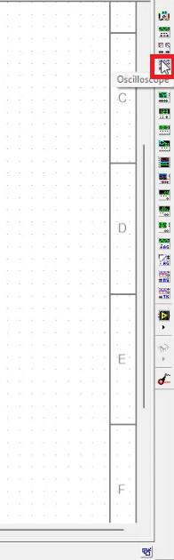

* **Conexión de Canales y Tierras:**
  - Conecta el **Canal A (CH1)** al nodo donde ingresa la señal de estímulo (por ejemplo, a la salida del generador de funciones).
  - Conecta el **Canal B (CH2)** al nodo de interés donde deseas medir la respuesta (por ejemplo, la salida del circuito tras pasar por un diodo rectificador o filtro).
  - Asegúrate de interconectar las terminales de tierra de los canales o utilizar el nodo de referencia común (`GND`) del circuito esquemático.

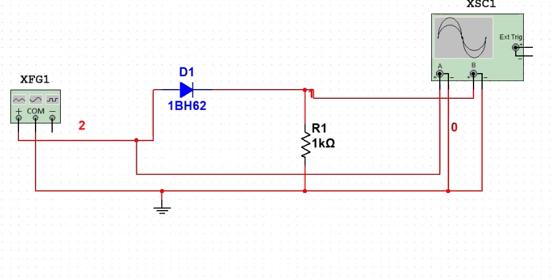

>  **Recomendación crítica de ruteo visual (Cambio de color de cables):**
> Por defecto, Multisim dibuja todas las líneas de conexión en color rojo. Para evitar confusiones al analizar múltiples señales superpuestas en la pantalla del osciloscopio:
> 1. Haz **clic derecho sobre el cable** que se conecta al Canal B.
> 2. En el menú contextual, selecciona **Properties** (Propiedades) o **Net Color** (Color de red).
> 3. Elige un color contrastante (por ejemplo, azul, amarillo o cian) y presiona **Aceptar**.
> 4. De esta manera, el trazo en la pantalla del osciloscopio coincidirá de forma exacta con el color asignado a cada cable.

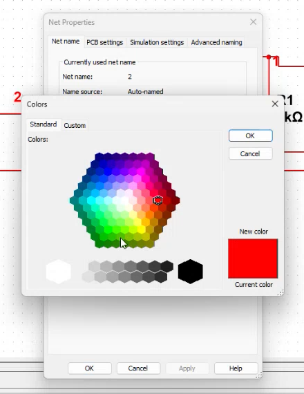

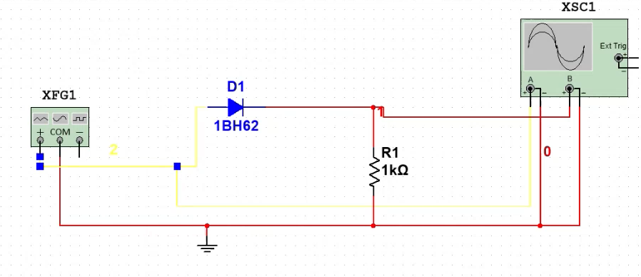

### Operación y Uso de la Función Auto-set
1. Haz clic en el botón verde **Correr** (`Run`) o presiona `F5` para iniciar el motor de simulación.
2. Haz **doble clic** sobre el icono del osciloscopio para desplegar la pantalla principal del equipo.
3. Si utilizas el modelo Tektronix, presiona el botón de encendido (**Power**).
4. Presiona el botón de ajuste automático (**Auto-set**). El osciloscopio analizará de inmediato las señales presentes en las entradas y recalibrará automáticamente la base de tiempo (Time/Div) y la escala de amplitud vertical (Volts/Div) de cada canal, mostrando las formas de onda perfectamente centradas, estables y sincronizadas.
5. **Análisis de Resultados:** Al comparar las ondas, podrás observar fenómenos físicos como la rectificación de media onda de un diodo (donde se permite el paso del semiciclo positivo y se bloquea por completo el semiciclo negativo al quedar en polarización inversa) o la atenuación y desfasamiento en filtros activos y pasivos.

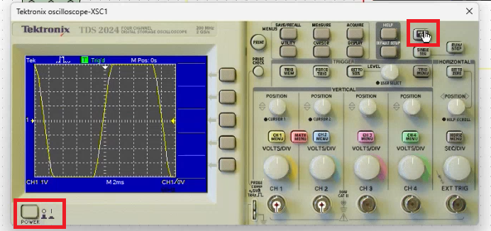

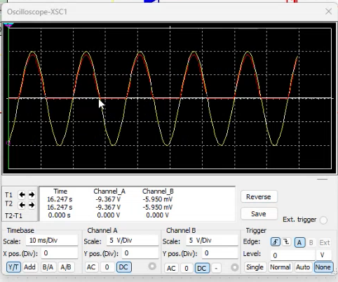
---

##  Consejos Prácticos de Ingeniería y Resolución de Problemas

- **Conflicto de Modos de Simulación:** Si al presionar el botón de inicio el programa muestra una advertencia de error o la simulación se congela, verifica el menú desplegable de la esquina superior derecha. Asegúrate de que el modo activo corresponda a **Interactive** para pruebas dinámicas con instrumentos o a **Analyses and Simulation** si ejecutas barridos matemáticos.
- **Importancia de la Tierra (`GND`):** Todos los circuitos analógicos y mixtos en Multisim requieren al menos una referencia a tierra física (0 V). Si olvidas colocarla, el motor de cálculo SPICE no podrá resolver la matriz nodal y arrojará un error de convergencia.
- **Validación previa a la manufactura:** La implementación metódica de esta guía y el dominio de las herramientas de Multisim te permitirán optimizar diseños, prevenir daños en componentes reales por sobrecorrientes y garantizar la funcionalidad de tus tarjetas de circuito impreso (PCB) desde la etapa teórica.
