# Guía Completa de Técnicas de Soldadura Electrónica (THT y SMD)

A continuación, se presenta la documentación técnica detallada para la correcta preparación, ejecución e inspección de uniones soldadas en circuitos impresos (PCBs), diseñada paso a paso para principiantes utilizando como caso práctico el ensamblaje de un módulo **UNIT Pulsar Nano C6** y una PCB personalizada.

---

## Índice
1. [Herramientas, Materiales y Preparación del Banco de Trabajo](#1-herramientas-materiales-y-preparación-del-banco-de-trabajo)
2. [Fundamentos Físicos de la Soldadura y Control Térmico](#2-fundamentos-físicos-de-la-soldadura-y-control-térmico)
3. [Preparación y Limpieza de la PCB](#3-preparación-y-limpieza-de-la-pcb)
4. [Técnica de Soldadura Superficial (SMD) Paso a Paso](#4-técnica-de-soldadura-superficial-smd-paso-a-paso)
5. [Técnica de Soldadura de Inserción (Through-Hole / THT) Paso a Paso](#5-técnica-de-soldadura-de-inserción-through-hole--tht-paso-a-paso)
6. [Inspección Óptica, Diagnóstico de Defectos y Pruebas Eléctricas](#6-inspección-óptica-diagnóstico-de-defectos-y-pruebas-eléctricas)
7. [Evidencia en Video del Proceso de Soldadura](#7-evidencia-en-video-del-proceso-de-soldadura)
8. [Recomendaciones de Seguridad y Mantenimiento del Equipo](#8-recomendaciones-de-seguridad-y-mantenimiento-del-equipo)
9. [Galería del Ensamblaje Final](#9-galería-del-ensamblaje-final)

---

## 1. Herramientas, Materiales y Preparación del Banco de Trabajo

Antes de encender el cautín, es indispensable organizar una estación de trabajo segura, iluminada y libre de estática para garantizar uniones limpias y evitar daños en los componentes electrónicos.

* **Cautín con control de temperatura:** Permite ajustar la energía térmica según el tamaño del *pad* y el tipo de aleación. Para electrónica general se recomienda una **punta tipo cincel (*chisel*) de $1.6\text{ mm}$ a $2.4\text{ mm}$**, ya que ofrece mayor superficie de contacto y transfiere el calor mucho más rápido que una punta cónica fina.
* **Aleación de soldadura:** Se utiliza hilo de soldadura electrónica con núcleo de resina (*rosin core*), como la aleación **$\text{Sn}_{60}\text{Pb}_{40}$** ($60\%$ estaño / $40\%$ plomo, diámetro de $0.8\text{ mm}$ a $1.0\text{ mm}$), ideal para principiantes por su bajo punto de fusión ($183\,^\circ\text{C} - 190\,^\circ\text{C}$) y excelente fluidez.
* **Flux en pasta o líquido:** Agente químico desoxidante que elimina la capa de óxido superficial del cobre y mejora la tensión superficial del estaño fundido.
* **Limpiador de punta:** Esponja celulósica ligeramente humedecida con agua destilada (nunca empapada, para evitar choques térmicos en la punta) o lana de latón.
* **Tapete antiestático de silicona y soporte con lupa ("tercera mano"):** Protegen la mesa de trabajo contra altas temperaturas, mantienen ordenados los componentes y permiten sujetar la placa con firmeza durante la soldadura.

  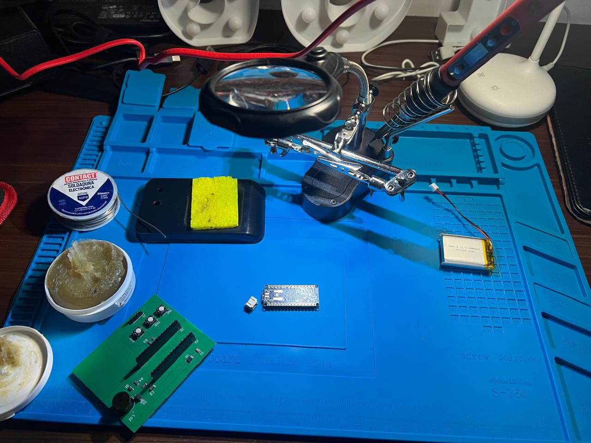 
  Figura: Configuración completa del banco de trabajo: tapete de silicona S-160, cautín digital con lupa y pinzas de sujeción, esponja húmeda, soldadura Sn60/Pb40, flux en pasta, módulo Pulsar Nano C6 y PCB base.

---

## 2. Fundamentos Físicos de la Soldadura y Control Térmico

Soldar en electrónica **no consiste en derretir estaño sobre la punta del cautín y "pegarlo" como si fuera silicón**. Una unión eléctrica y mecánicamente confiable se logra mediante un proceso metalúrgico llamado **mojabilidad (*wetting*)**, en el cual el estaño fundido reacciona superficialmente con el cobre limpio del *pad* y el terminal del componente formando una aleación intermetálica continua.

   
  Figura: Corte transversal de una unión Through-Hole correcta: la punta del cautín a 45° calienta simultáneamente el pad de cobre y el pin del componente mientras el hilo de soldadura se alimenta desde el lado opuesto.

### Parámetros de Temperatura Recomendados

| Tipo de Aleación | Composición | Punto de Fusión | Temperatura de Cautín (THT / SMD estándar) |
| :--- | :--- | :--- | :--- |
| **Con Plomo (Eutéctica / Estándar)** | $\text{Sn}_{63}\text{Pb}_{37}$ / $\text{Sn}_{60}\text{Pb}_{40}$ | $183\,^\circ\text{C} - 190\,^\circ\text{C}$ | **$310\,^\circ\text{C} - 340\,^\circ\text{C}$** |
| **Libre de Plomo (Lead-Free)** | $\text{SAC305}$ ($\text{Sn}_{96.5}\text{Ag}_{3.0}\text{Cu}_{0.5}$) | $217\,^\circ\text{C} - 220\,^\circ\text{C}$ | **$350\,^\circ\text{C} - 380\,^\circ\text{C}$** |

> **Regla de oro del tiempo de contacto:** Una unión estándar debe completarse en **$2\text{ a }3\text{ segundos}$**. Si necesitas más de $5\text{ segundos}$ para que el estaño fluya, la punta del cautín está sucia, oxidada, es demasiado fina para el tamaño del *pad* o la temperatura configurada es insuficiente. Mantener el calor excesivo sobre la placa provoca el desprendimiento de las pistas de cobre (*pad lifting*).

---

## 3. Preparación y Limpieza de la PCB

Antes de colocar cualquier componente, se debe inspeccionar visualmente la tarjeta de circuito impreso para verificar que los *pads* no presenten suciedad, grasa de los dedos ni residuos de fabricación.

1. **Limpieza previa:** Frota suavemente las zonas a soldar con un hisopo o cepillo antiestático humedecido en **alcohol isopropílico (IPA al $99\%$)** y deja evaporar por completo.
2. **Identificación de polaridad y huellas (*footprints*):** Verifica en la serigrafía de la PCB la orientación de los conectores, diodos, capacitores polarizados y terminales de alimentación (`+` y `-`).

  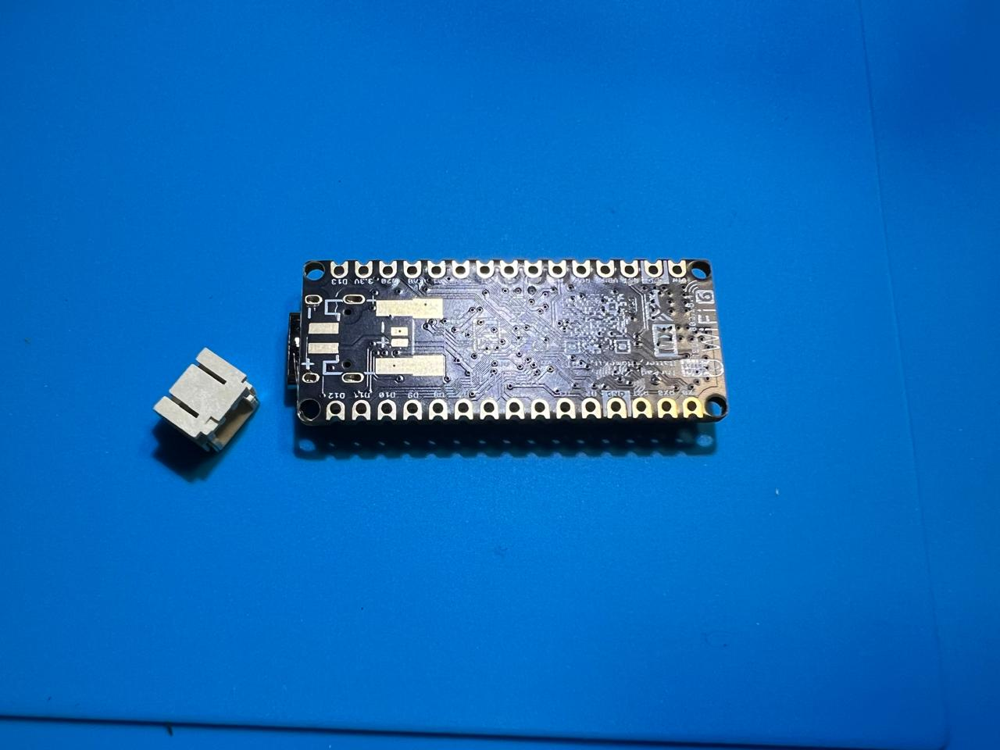 
  Figura: Vista posterior del módulo UNIT Pulsar Nano C6 con los pads perimetrales y las pistas de alimentación limpios antes del proceso de soldadura.

  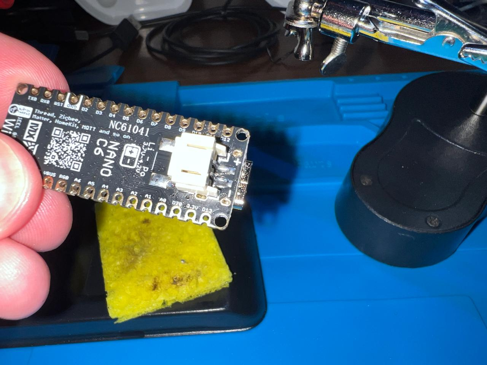 
  Figura: Acercamiento de los pads SMD superiores destinados al conector de batería Li-Po (3.7V–4.2V) con su respectiva serigrafía de polaridad (+ y -).

---

## 4. Técnica de Soldadura Superficial (SMD) Paso a Paso

Para soldar componentes de montaje superficial (*Surface Mount Device*), como el conector de batería **JST PH $2.0\text{ mm}$** en el módulo Pulsar Nano C6, se emplea la técnica de **pre-estañado (*pre-tinning*)** en un solo *pad* de anclaje:

1. **Aplicación de flux y pre-estañado (*Pre-tinning*):** Aplica una pequeña cantidad de flux sobre los *pads* SMD y deposita una gota delgada y brillante de estaño únicamente en **uno de los *pads* de esquina o anclaje**, dejando el resto limpios y planos para que el componente asiente sin inclinarse.

  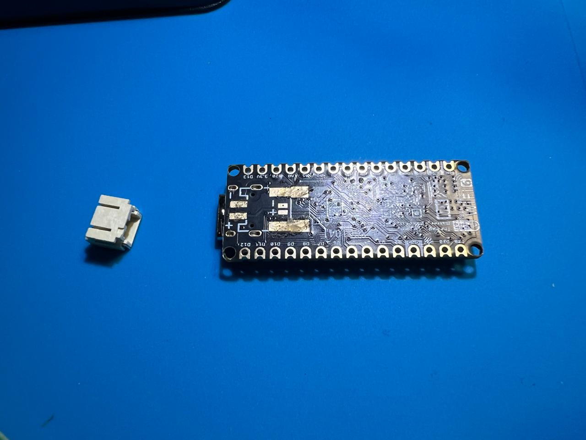 
  Figura: Aplicación de una capa inicial de estaño (pre-tinning) sobre los pads de refuerzo antes de posicionar el componente SMD.

2. **Posicionamiento y fijación inicial:** Sujeta el conector SMD con pinzas de precisión, alínealo exactamente sobre los *pads* verificando la polaridad (`+` y `-`) y refunde con el cautín el estaño previamente depositado en el primer *pad*. Retira el cautín sin soltar las pinzas durante $2\text{ segundos}$ hasta que el estaño solidifique y fije el componente.
3. **Soldadura de los terminales restantes:** Una vez inmovilizado el componente, aplica flux en el terminal opuesto y en las pestañas laterales de sujeción mecánica; calienta cada unión y alimenta una mínima cantidad de hilo de soldadura hasta cubrir el *pad* por completo.

  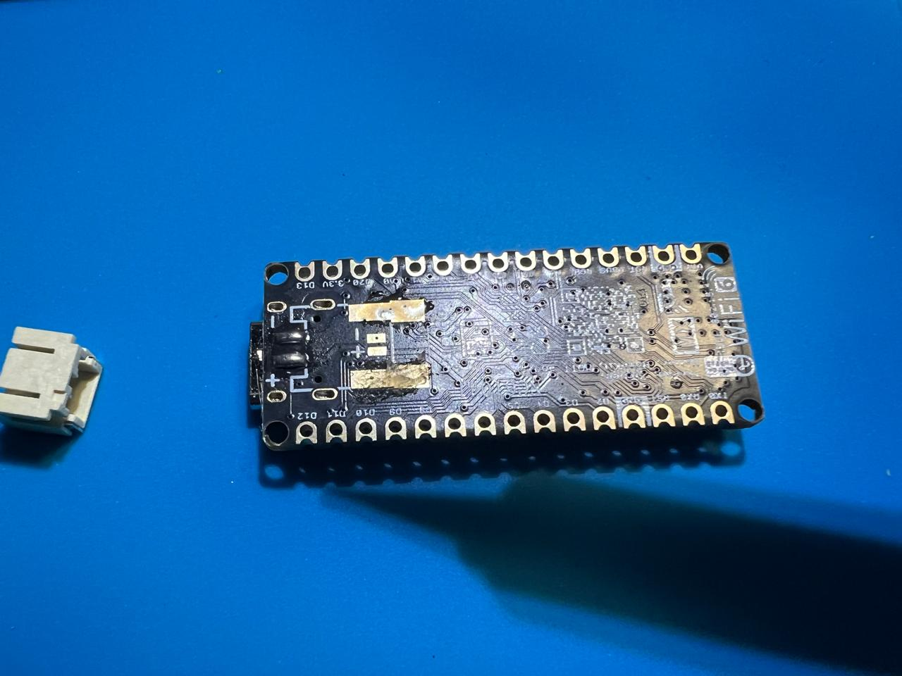 
  Figura: Unión de los anclajes metálicos tras aplicar flux en pasta; nótese el residuo ámbar de flux que debe limpiarse al finalizar.

4. **Limpieza post-soldadura:** Retira los restos de flux utilizando un cepillo de cerdas suaves e **alcohol isopropílico**, asegurando que no queden residuos pegajosos ni micro-esferas de estaño entre terminales adyacentes.

  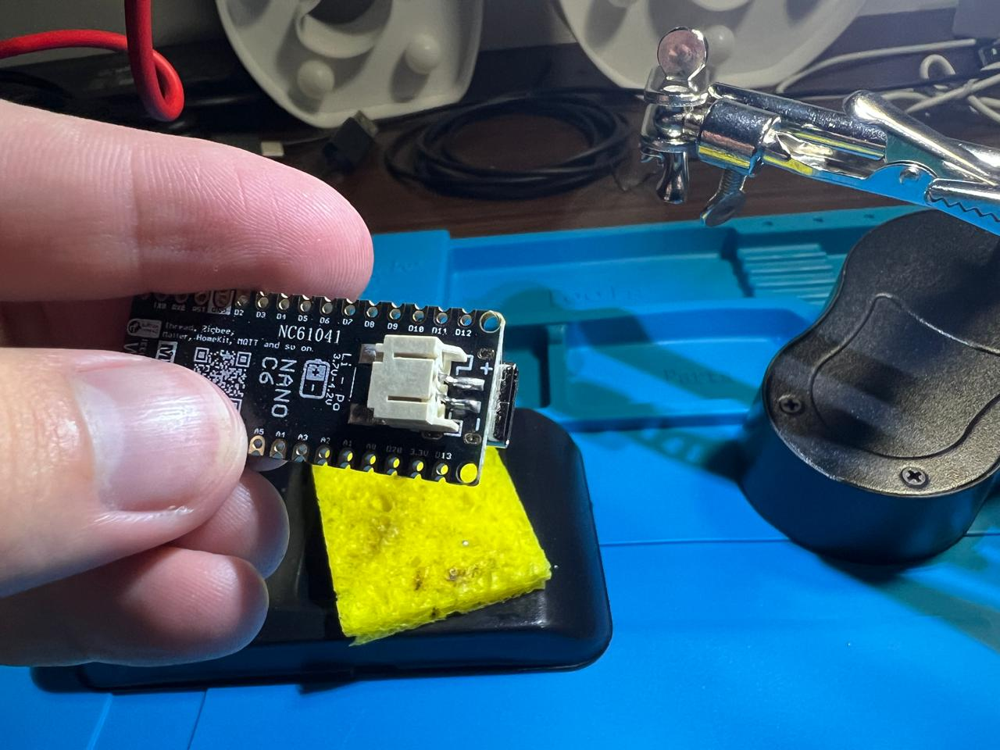 
  Figura: Resultado de la soldadura SMD del conector JST PH 2.0 mm sobre la Pulsar Nano C6, mostrando filetes brillantes y alineación paralela a la placa.

  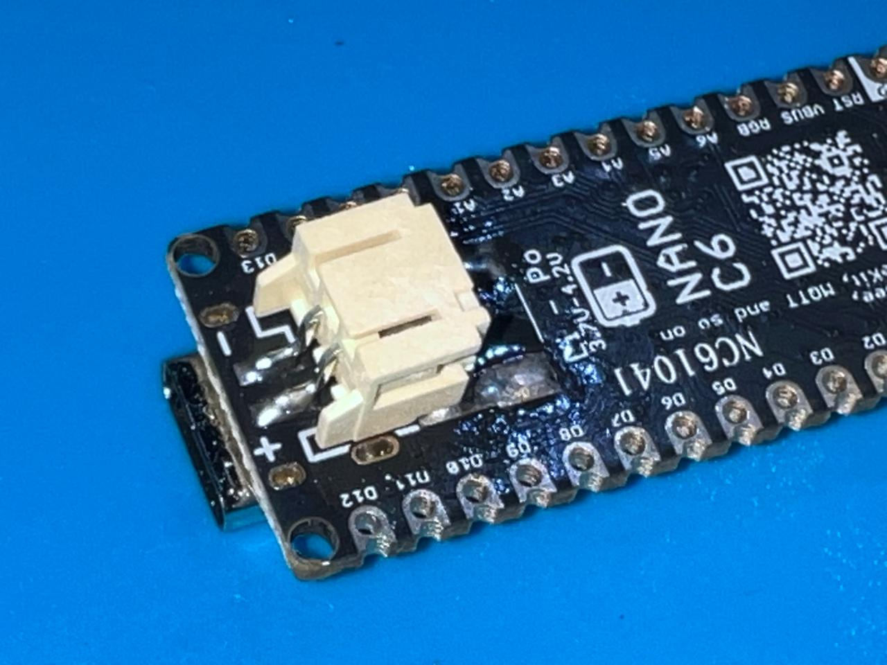 
  Figura: Vista en detalle tras la limpieza con alcohol isopropílico, verificando la integridad de los terminales positivo (+) y negativo (-).

---

## 5. Técnica de Soldadura de Inserción (Through-Hole / THT) Paso a Paso

Los componentes de inserción (*Through-Hole Technology*), como tiras de pines (*pin headers*), *headers* hembra, botones pulsadores (`SW1`, `SW2`, `SW3`) y zumbadores (`LS1`), atraviesan la placa mediante perforaciones metalizadas.

1. **Inserción y alineación mecánica:** Introduce el componente por la cara superior de la PCB. **Truco profesional:** Si vas a soldar tiras de *pin headers*, insértalas previamente en una *protoboard* o en los *headers* hembra de la placa receptora antes de soldar; esto actúa como plantilla rígida para garantizar que todos los pines queden perfectamente perpendiculares ($90^\circ$) y encajen sin esfuerzo.
2. **Calentamiento simultáneo ($45^\circ$):** Limpia la punta del cautín, estaña ligeramente su extremo para mejorar el puente térmico y apóyala en un ángulo de **$45^\circ$** tocando **al mismo tiempo el anillo de cobre (*pad*) y el pin metálico** durante aproximadamente $1\text{ segundo}$.
3. **Alimentación del hilo de soldadura:** Sin mover el cautín, acerca el hilo de estaño al punto de unión desde el **lado opuesto a la punta del cautín** (nunca directamente sobre la punta). El calor del *pad* y del pin fundirá el estaño, que fluirá por capilaridad rellenando el barreno y formando un **menisco cóncavo ("volcán")** brillante y liso.
4. **Retiro ordenado:** Retira primero el hilo de soldadura y medio segundo después el cautín siguiendo el eje del pin. Mantén la placa completamente inmóvil mientras la junta enfría.
5. **Corte de terminales sobrantes:** En componentes con patas largas (resistencias, capacitores o LEDs), corta el exceso de alambre con pinzas de corte al ras **justo por encima del cono de soldadura**, sin morder el filete metálico ni generar tensión mecánica sobre el *pad*.

  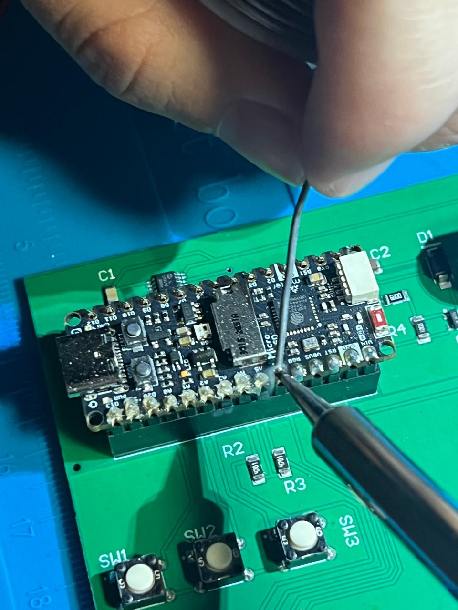 
  Figura: Cara de soldadura de la PCB personalizada mostrando las uniones Through-Hole de los pulsadores (SW1–SW3) y los headers centrales (J1, J2).

  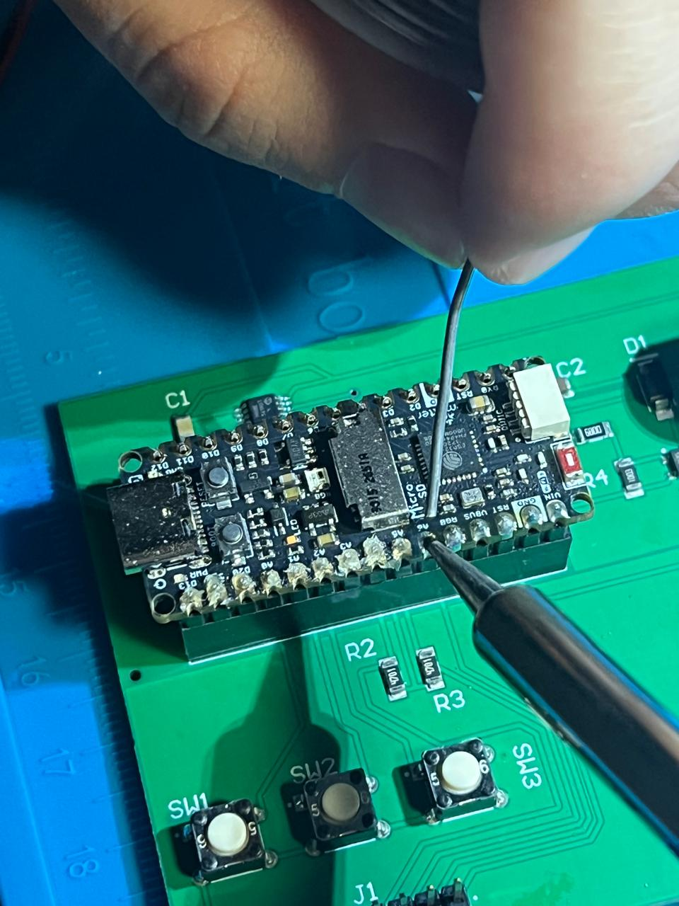 
  Figura: Vista en ángulo que permite comprobar la geometría cóncava y el acabado espejo característico de una transferencia térmica adecuada.

  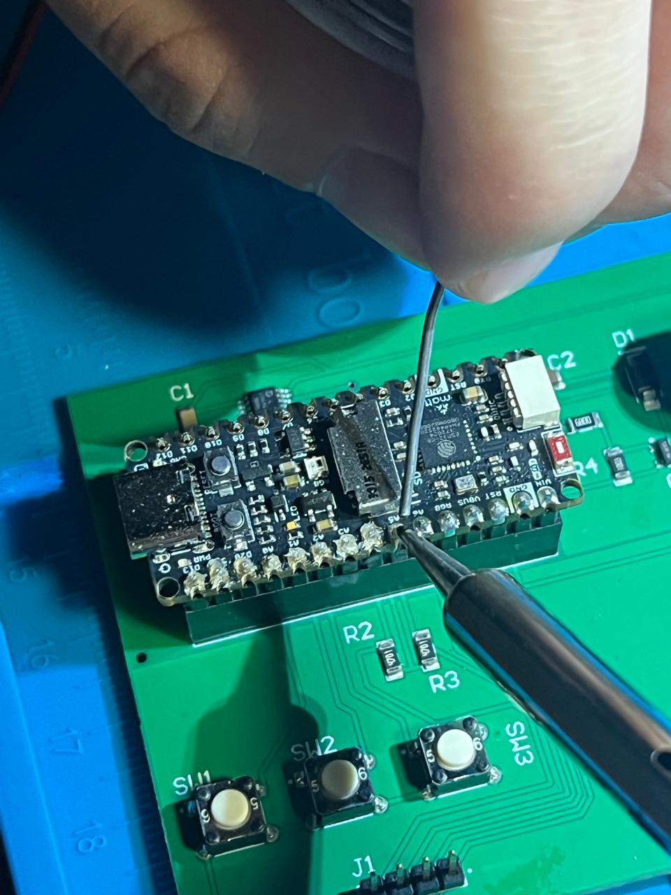 
  Figura: Acercamiento de las hileras de pines de los headers centrales verificando que cada pad esté cubierto al 100% sin puentes entre pines vecinos.

  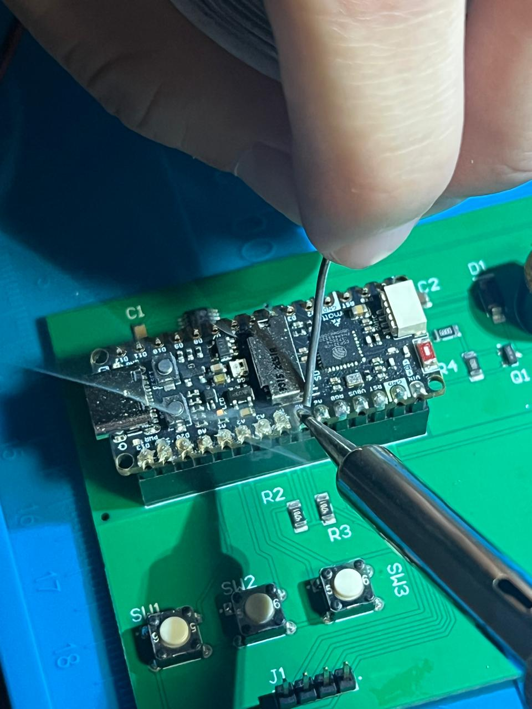 
  Figura: Vista en perspectiva de la tarjeta completa tras finalizar todas las soldaduras de inserción y montaje superficial.

---

## 6. Inspección Óptica, Diagnóstico de Defectos y Pruebas Eléctricas

Toda placa soldada debe someterse a una **inspección óptica con lupa** y a una **verificación eléctrica con multímetro** antes de conectarla a una fuente de alimentación o puerto USB.

   
  Figura: Guía visual de diagnóstico comparando el perfil transversal de una junta ideal frente a los cuatro errores más frecuentes en soldadura electrónica.

### Tabla de Diagnóstico y Corrección de Errores Comunes

| Defecto Visual | Apariencia Física | Causa Principal | Método de Corrección |
| :--- | :--- | :--- | :--- |
| **1. Junta Ideal** | Menisco cóncavo suave, superficie brillante tipo espejo, cubre el $100\%$ del *pad* y abraza el pin. | Temperatura, tiempo y limpieza óptimos. | Ninguna; la unión cumple con el estándar de calidad. |
| **2. Soldadura Fría** | Superficie opaca, grisácea, grumosa o agrietada; mala conducción eléctrica. | Movimiento del pin durante el enfriamiento o temperatura insuficiente del cautín. | Aplicar flux fresco y recalentar la unión con el cautín hasta que el estaño vuelva a fluir y brille. |
| **3. Exceso de Estaño** | Forma esférica o abultada ("bola"); oculta el contorno del pin y puede ocultar falta de adhesión al *pad*. | Alimentación excesiva de hilo de soldadura. | Retirar el excedente con **malla desoldadora (*solder wick*)** impregnada en flux y volver a estañar moderadamente. |
| **4. Falta de Mojabilidad** | El estaño se adhiere solo al pin o solo al *pad* sin unir ambas superficies. | Se calentó únicamente una de las partes o la superficie estaba oxidada. | Aplicar flux y apoyar la punta del cautín asegurando contacto simultáneo con el *pad* y el pin. |
| **5. Puente / Cortocircuito** | El estaño une dos *pads* o pines adyacentes creando una conexión eléctrica no deseada. | Exceso de estaño o falta de flux en pines con paso fino (*fine pitch*). | Aplicar flux sobre el puente y deslizar la punta limpia del cautín o absorber con malla desoldadora. |

  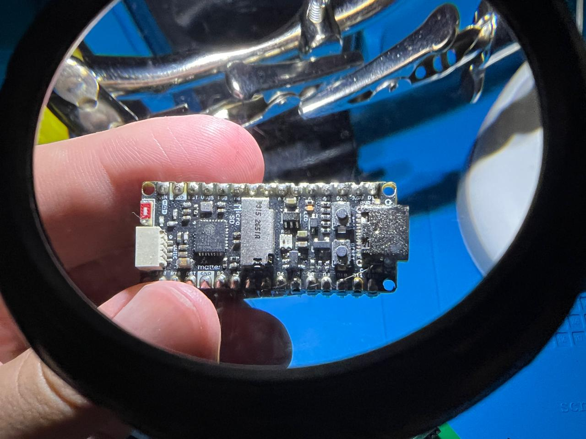 
  Figura: Inspección óptica bajo lupa de la cara superior de la Pulsar Nano C6, comprobando que el estaño haya ascendido por capilaridad en cada pin header sin generar cortocircuitos.

  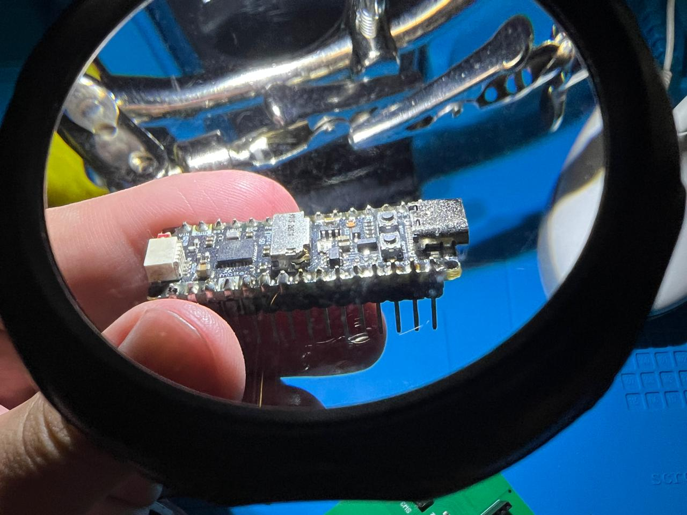 
  Figura: Revisión lateral bajo lupa para confirmar la perpendicularidad de los pines inferiores y la integridad de los componentes SMD cercanos al conector USB-C.

### Prueba Obligatoria de Continuidad
Antes de energizar el circuito:
1. Coloca el multímetro en **modo de continuidad (símbolo de diodo / zumbador)**.
2. Mide entre las líneas de alimentación (**`VBUS`**, **`VIN`**, **`3.3V`**) y tierra (**`GND`**).
3. El multímetro **no debe emitir pitido continuo** (un pitido breve de fracción de segundo es normal mientras se cargan los capacitores de desacoplo). Si existe continuidad permanente, revisa inmediatamente con lupa en busca de un puente de estaño.

---

## 7. Evidencia en Video del Proceso de Soldadura

A continuación se muestra el registro en video de la técnica aplicada para soldar los pines (*pin headers*) del módulo **UNIT Pulsar Nano C6**, respetando los tiempos de calentamiento y la alineación mecánica:

* **Soldadura de Pines en el Módulo Pulsar Nano C6:**
  <video controls width="100%">
    <source src="../recursos/imgs/soldadura_pines_pulsar.mp4" type="video/mp4">
    Tu navegador no soporta la reproducción de video.
  </video>
  Ejecución paso a paso de la soldadura Through-Hole en los pines del módulo UNIT Pulsar Nano C6, mostrando el calentamiento simultáneo del pad y el pin, la alimentación del estaño y la formación del menisco cóncavo.

---

## 8. Recomendaciones de Seguridad y Mantenimiento del Equipo

> **Nota:** Se recomienda aplicar estrictamente las siguientes medidas de seguridad y cuidado del equipo durante cada sesión de soldadura:
>
> * **Ventilación y extracción de humos:** Los vapores generados al quemar el flux irritan las vías respiratorias y los ojos. Trabaja siempre en un área ventilada o utiliza un extractor de humos con filtro de carbón activado; nunca inhales directamente el humo que asciende de la unión.
> * **Cuidado y estañado de la punta (*Tip Tinning*):** Nunca lijes ni limes la punta del cautín, ya que destruirías su recubrimiento protector de hierro y se corroerá en minutos. Antes de apagar el cautín, limpia la punta en la esponja húmeda y **déjala cubierta con una capa generosa de estaño fresco** para evitar que se oxide mientras está almacenada.
> * **Precaución crítica con baterías Li-Po:** Nunca intentes soldar cables directamente sobre las lengüetas de una batería de polímero de litio ni conectes la batería durante el proceso de soldadura. Verifica siempre con el multímetro la polaridad (`+` y `-`) del conector JST antes de conectar la celda por primera vez para evitar daños irreversibles en el regulador de carga.
> * **Protección ocular y térmica:** Utiliza gafas de seguridad al cortar terminales de componentes (los recortes metálicos salen proyectados a alta velocidad) y apaga o coloca el cautín en su base metálica cada vez que sueltes el mango.

---

## 9. Galería del Ensamblaje Final

A continuación se muestra el resultado final de la integración entre el módulo **UNIT Pulsar Nano C6** y la PCB base tras completar las etapas de soldadura SMD, THT, limpieza e inspección:

  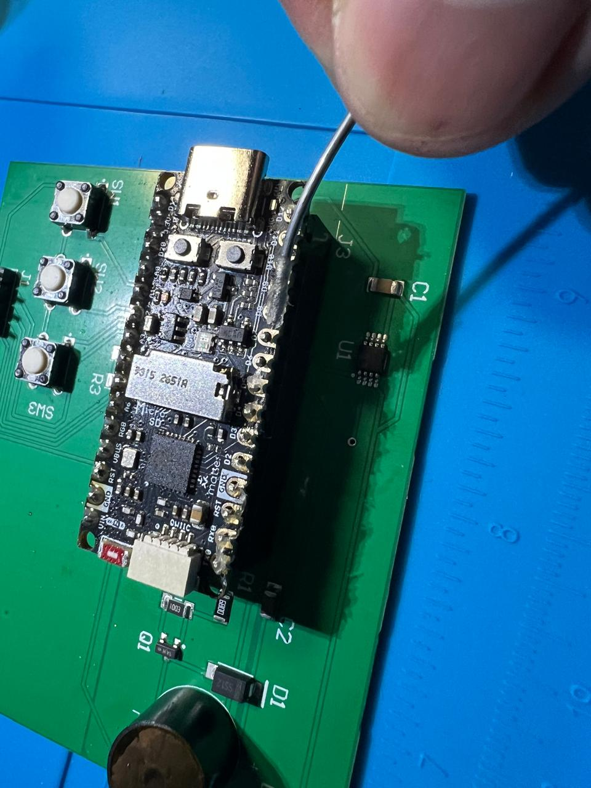 
  Figura: Vista general del sistema ensamblado mostrando el módulo Pulsar Nano C6 montado sobre los headers de la PCB personalizada junto con los pulsadores y el zumbador.

  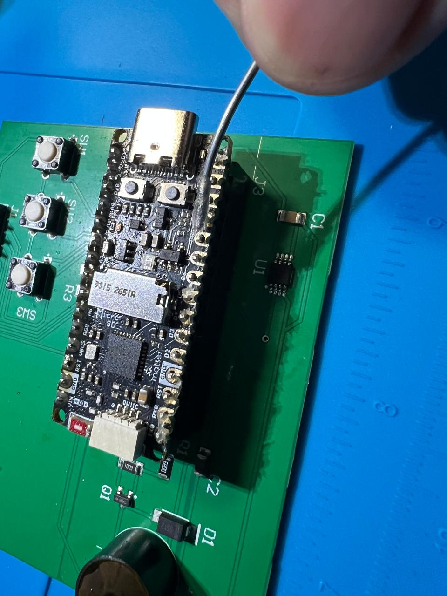 
  Figura: Vista en detalle del acoplamiento mecánico y eléctrico final listo para pruebas de firmware.

---

Evidencias de mi primer trabajo de soldadura 

  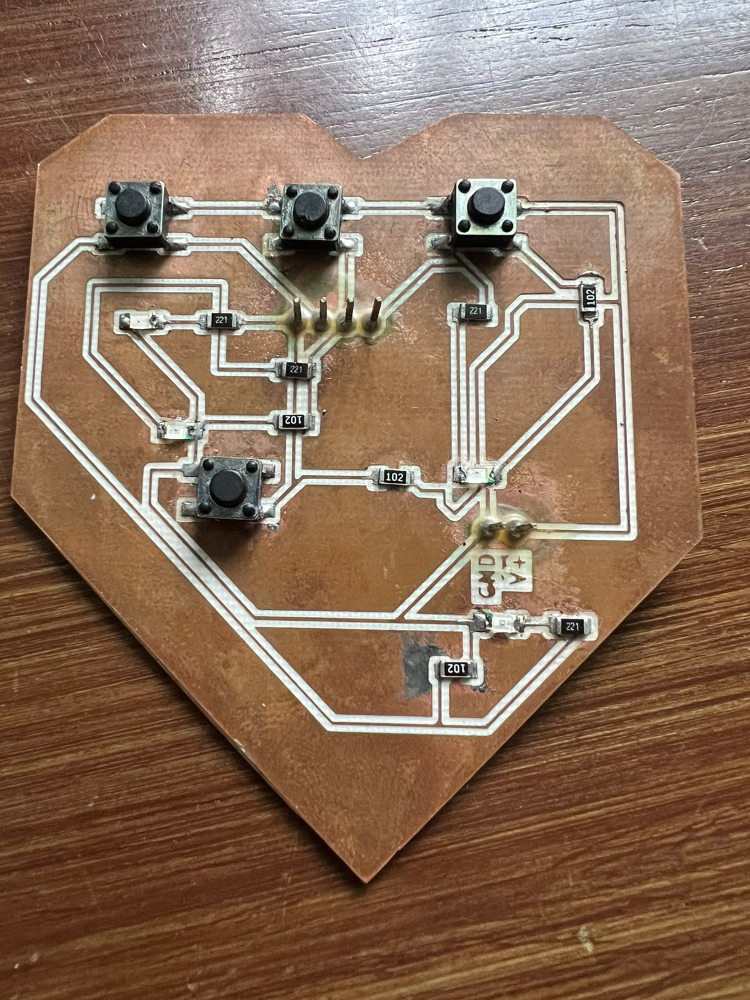 
  Figura: Vista en detalle del acoplamiento mecánico y eléctrico final listo para pruebas de firmware.

